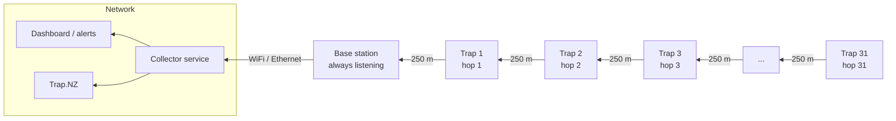
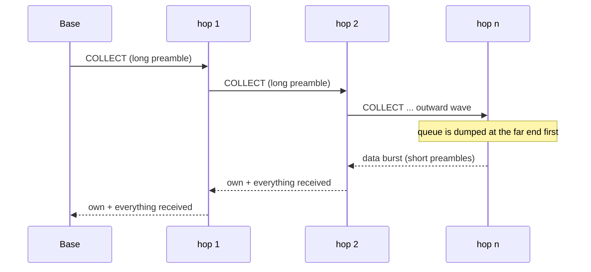
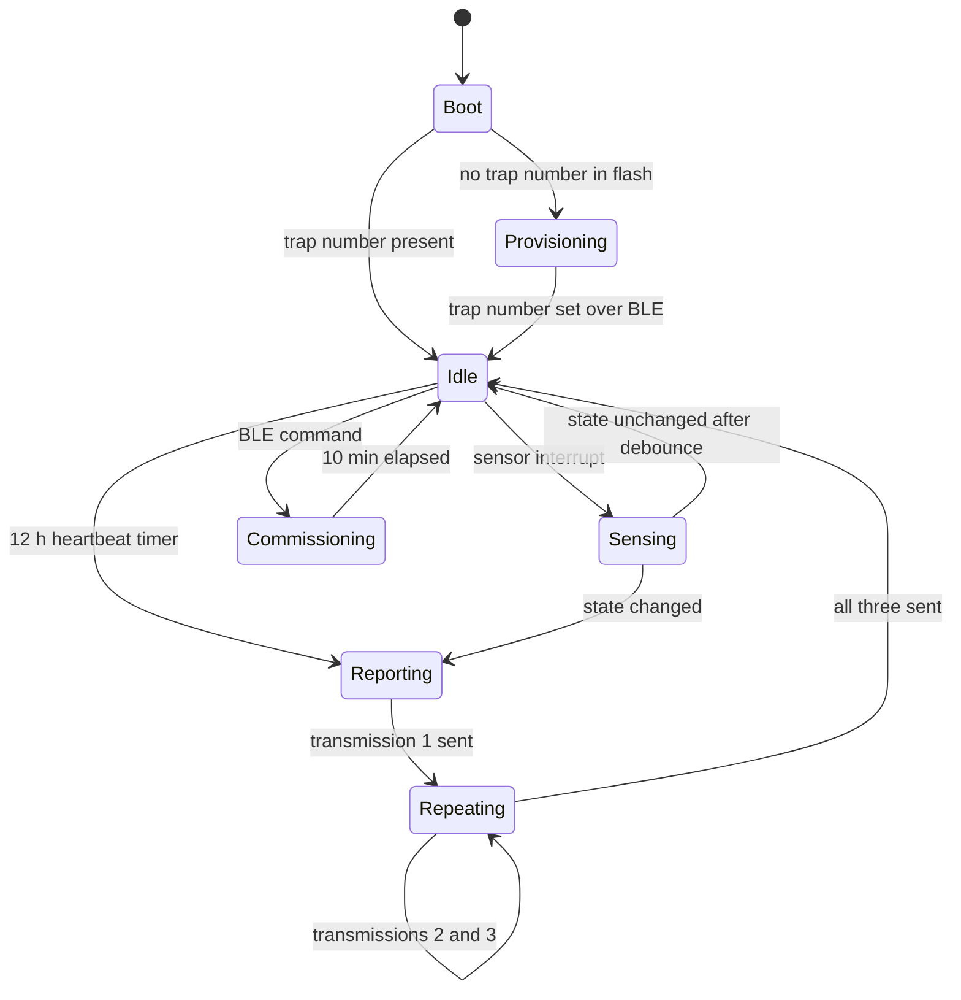

# TrapLineLoRa — System Design Specification

| | |
|---|---|
| **Version** | 1.0.4 — relayed chain |
| **Date** | 2026-08-21 |
| **Status** | Open for iteration. §17 lists what still needs deciding. |
| **Hardware** | Seeed Studio XIAO nRF52840 + Wio-SX1262 (SKU 102010710) |
| **Region** | New Zealand, 915–928 MHz |

This document captures the design we intend to implement. It is deliberately
specific about the things that are expensive to change later — the on-air frame
format, the addressing scheme, the power architecture — and deliberately vague
about the things that are cheap to change. Numbered requirements exist so
implementation work can cite them.

**Changed in 0.2:** heartbeat period is 12 hours; every report is sent as three
transmissions with randomised spacing; the node no longer listens for
acknowledgements in normal operation.

**Changed in 0.3:** the line is 32 traps and one base. Every node now carries an
immutable 64-bit hardware device ID alongside its mutable trap number (§7.8).

**Changed in 0.4:** the farthest trap is **3 km with no line of sight**, which is
at the edge of what this radio can do and may not be reachable at all (§6.3 —
read this before anything else). Survey mode replaces the ping-pong firmware as
the Phase 0 tool: the base beacons, a node in your hand measures the path, and a
phone displays it over BLE (§7.9).

**Changed in 0.5:** a gap review. Added §8.7 (how BLE is reachable on a sleeping
node at all — it wasn't), corrected §8.4 (the battery divider must never be
driven high), and added Q12–Q18 covering battery chemistry, enclosure, antenna
position, event timing across an outage, base monitoring, firmware update and
who builds 32 units. Q3 promoted: the trap mechanism decides the data model, not
just the wiring.

**Changed in 0.6:** Q3 and Q8 answered — the trap is **single-trigger and
hand-reset** (the state model stands), and the battery target drops to **1 year**
(§11.0), which relaxes the budget twelvefold and buys back always-on BLE, SF12
everywhere, and optionally acks. Added §8.6 on antenna design for a
**ground-level mount on a wooden box** — the hardest RF constraint in the
project. §9.1 rewritten with base-station options including a concentrator.

**Changed in 0.7:** the node antenna is confirmed **box-mounted, ≤ 0.5 m**
(§6.3 — the far trap is now a coin flip with every available dB already spent),
and the link is **two-way again**: an ack on every report carrying configuration
and link telemetry (§7.2, §7.3), plus a low-duty `SetRxDutyCycle` listener for
remote wake (§7.11).

**Changed in 1.0 — the star became a chain.** Traps are 250 m apart at ground
level in wet bush, where direct node-to-base range is about 600 m, so only the
first two or three traps could ever reach the base. **Every node now relays for
the ones beyond it**, with the base at one end of a 31-hop line (§4, §7.10).

Three things fell out of that, and they are why v1.0 is a *better* design than
v0.7 rather than merely a more complicated one:

- **Every link is now 250 m.** The Yagi, the sector antenna, SF12/BW62.5 and the
  multi-spreading-factor base are all unnecessary. Plain omni antennas, one
  spreading factor everywhere, 17 dB of margin per hop.
- **Reports must be batched into collection sweeps.** Waking a sleeping
  neighbour costs a 2.38 s preamble, so the obvious wake-per-report design costs
  the hop-2 node 15 mAh/day against a 7.1 mAh/day allowance. Batched 12-hourly
  sweeps cost the worst node 1.5 mAh/day (§7.10.1).
- **A dead node orphans everything beyond it** — but the base identifies which
  node for free, because a contiguous run of trap numbers goes quiet at once.

See the change log.

---

## 1. Purpose and scope

A trap line is a string of predator traps along a track or ridge. Someone has to
walk it to find out which traps have fired. This system reports that remotely:
each trap gets a battery-powered radio node, every node reports to a single base
station at a hut or shed, and the base station puts the data somewhere a human
can see it.

**In scope**

- Trap node firmware: trap-sprung detection, battery reporting, heartbeat, sleep.
- The on-air protocol between nodes and the base station.
- Base station firmware and its hand-off to a network service.
- Provisioning: assigning a trap number to a node in the field.

**Out of scope for v1**

- Multi-hop relaying between nodes (see §17, Q2 — this is the most likely
  reason v1 fails to cover a real line).
- Bait level, animal-count, or camera payloads.
- Remote firmware update over the air.
- Remote reconfiguration of a deployed node (see §17, Q10 — a consequence of
  the no-downlink decision, and one worth understanding before deployment).

---

## 2. Context and constraints

| Constraint | Consequence |
|---|---|
| 32 traps, one base station | Small enough that a site visit to every node is a day's work, not a week's. This is what makes the no-downlink decision (§7.3) affordable. It also means channel capacity is a non-issue (§6.4). |
| **Farthest trap is 3 km with no line of sight** | **The binding constraint on the entire project.** Whether it is reachable at all depends on vegetation and terrain geometry, which nobody knows yet. §6.3 shows the link closes over scrub and fails through bush, with nothing in the protocol able to make up the difference. |
| Nodes are unattended for months in wet, cold NZ bush | Sleep current, not radio activity, sets battery life (§11). Enclosure and connector choice matter as much as firmware. |
| Star topology, one base station | Every trap must be within one radio hop of the base. This is the binding constraint on where the base can go, and it may not survive contact with a real line. |
| The base has mains power and WiFi/Ethernet at a hut | The base can listen continuously and does not need a power budget. This is a large simplification — exploit it. |
| Nodes never listen (§7.6) | The node has no idea whether it is being heard. All link diagnosis moves to the base. In exchange, node energy use is completely independent of link quality. |
| Traps are cheap; a node costs more than the trap it watches | Bill of materials pressure is real. Keep the node to XIAO + Wio-SX1262 + switch + battery + box. |
| A false "sprung" report costs a wasted walk; a missed one costs a rotting catch | Missed detections are worse than duplicates. Deliver at least once; deduplicate at the base. |

---

## 3. Glossary

| Term | Meaning |
|---|---|
| **Node** | The XIAO + Wio-SX1262 assembly watching one trap. |
| **Trap number** | The human-facing identifier painted on the trap, 1–65534. Mutable. Also the node's radio address. |
| **Device ID** | The nRF52840's factory-programmed 64-bit `FICR.DEVICEID`. Immutable, unique, survives reflashing. The node's true identity (§7.8). |
| **Base** | The single always-on receiver at the hut. |
| **Report** | One logical message from a node. Sent as three transmissions (§7.6). |
| **Transmission** | One frame on the air. Three transmissions carry one report. |
| **Event** | A change of trap state that the node reports immediately. |
| **Heartbeat** | A periodic "still alive" report, sent whether or not anything happened. |
| **Frame counter** | A per-node, per-**report** counter that never repeats. The deduplication and replay-rejection key. |
| **TLP** | Trap Line Protocol — the frame format defined in §7. |

---

## 4. System architecture

**The network is a chain, not a star.** Traps sit 250 m apart at ground level in
wet bush, where direct node-to-base range is around 600 m (§17 addendum). Only
the first two or three traps could ever reach the base directly, so every node
relays for the ones beyond it. The base sits at one end of the line, giving a
worst case of 31 hops.



Five layers, each with a clean boundary so they can be built and tested
independently:

1. **Node** — sleeps, senses, and relays for its neighbours. §8.
2. **Radio link (TLP)** — fixed-size authenticated frames, one hop at a time. §7.
3. **Relay layer** — hop discovery, collection sweeps, per-hop acknowledgement,
   duplicate suppression. **§7.10 — this is the substance of v1.0.**
4. **Base** — receives, authenticates, deduplicates, buffers, forwards. Stateless
   about meaning; it does not know what a trap *is*.
5. **Collector service** — maps trap numbers to real-world traps, applies
   business rules ("node 14 has been silent for 3 days"), talks to Trap.NZ.

Three consequences of the chain worth stating up front, because they run
counter to the earlier star design:

- **Every radio link in the system is now about 250 m.** Nothing has to reach
  3 km. That removes the Yagi, the sector antenna, the SF12/BW62.5 heroics and
  the multi-spreading-factor base — every link runs the same SF10 with plain
  omni antennas and 17 dB of margin.
- **Relay traffic, not sensing, now sets the energy budget**, and it concentrates
  near the base. §11.3 shows this is affordable only if reports are *batched*;
  the obvious design where each node wakes its parent per report costs the hop-2
  node 15 mAh/day against a 7.1 mAh/day allowance.
- **A chain has a single point of failure at every link.** §7.10.6 and §14.

---

## 5. Requirements

### 5.1 Functional

| ID | Requirement |
|---|---|
| **FR-1** | A node shall detect a change in trap state (set → sprung, sprung → set) and **begin transmitting within 60 s**; the report shall reach the base **within 5 minutes** via the event fast path (§7.10.5). |
| **FR-2** | Every report shall carry the trap number, so a report is meaningful without reference to radio-layer identity. |
| **FR-3** | A node shall queue a heartbeat report every **12 hours** and deliver it on the next collection sweep, whether or not the trap state has changed. |
| **FR-4** | Every report shall carry the node's battery voltage in millivolts. |
| **FR-5** | Every frame shall be **acknowledged by the receiving hop**, and retried up to **three times** before the sender falls back to its secondary parent. (Restated in 1.0: three *attempts per hop*, stopping on acknowledgement, replaces v0.2's three blind end-to-end transmissions — same intent, applied where a chain can afford it. See §7.10.4.) |
| **FR-20** | Each node shall discover its hop count and its two best parents automatically from a daily `TOPO` frame, and shall accept a manual override set over BLE (§7.10.2). |
| **FR-21** | The base shall initiate a collection sweep every 12 hours; each node shall forward the sweep outward once, then return its own queued reports plus everything received from beyond it, in a single burst (§7.10.3). |
| **FR-22** | A relaying node shall suppress duplicate `(trap_id, counter)` pairs it has already forwarded (§7.10.6). |
| **FR-23** | A node shall hold undelivered reports across sweeps and retry them, up to the capacity of its queue. |
| **FR-24** | The base shall identify a chain break by the contiguous run of trap numbers that has fallen silent, and name the node most likely to have failed. |
| **FR-6** | The base shall accept the first transmission of a report and discard the other two, keyed on trap number and frame counter. |
| **FR-7** | The base shall reject frames that fail message authentication, and count them. |
| **FR-8** | A node's trap number shall be settable in the field over BLE, without a cable, and shall persist across power loss. |
| **FR-9** | A node shall report whether it is transmitting for the first time since power-up, so a node that has reset unexpectedly is visible. |
| **FR-10** | The base shall forward accepted reports to the collector service, and shall buffer them if the network is down. |
| **FR-11** | The collector service shall raise an alert when a node misses a configurable number of consecutive expected heartbeats. |
| **FR-12** | A node shall report a low-battery flag when battery voltage falls below a configurable threshold. |
| **FR-13** | Every report shall carry a count of trap state changes since power-up, so the base can detect a report it never received. |
| **FR-14** | A node in commissioning mode shall listen for an acknowledgement so an installer can confirm coverage before closing the enclosure. |
| **FR-15** | Each node shall have an immutable 64-bit device ID that survives power loss, factory reset and reflashing, and shall report it periodically and whenever its trap number changes (§7.8). |
| **FR-16** | The base shall detect and flag two conditions: two device IDs claiming the same trap number, and a trap number whose device ID has changed. |
| **FR-17** | The base shall provide a time-limited survey mode in which it transmits beacons carrying its transmit power, antenna gain, measured noise floor and a sequence number (§7.9). |
| **FR-18** | A node in survey mode shall measure RSSI, SNR and packet error rate from those beacons, compute the predicted uplink margin for every spreading factor, and present it over BLE. |
| **FR-19** | A node shall be able to record labelled survey measurements and export them over BLE as CSV. |

### 5.2 Non-functional

| ID | Requirement |
|---|---|
| **NFR-1** | A node shall run for at least **1 year** on the specified pack — **2 × 800 mAh Li-ion in parallel, 1600 mAh nominal** — under the nominal reporting schedule (§11). Sizing uses the *cold, aged* figure of ~1250 mAh, not the nameplate. |
| **NFR-2** | **Average** node current — measured at the battery terminals, enclosure closed, over a full sweep cycle — shall not exceed **110 µA** at 3.7 V. The design estimate for the chosen configuration (§11.0) is **97 µA**; the requirement leaves 13 % for the gap between estimate and bench. 110 µA on a 1250 mAh cold pack is 1.30 years. **This is thinner margin than the earlier 18650 assumption allowed, and it makes the Phase 1 current measurement a gate rather than a formality.**
| **NFR-3** | The system shall comply with the NZ General User Radio Licence for Short Range Devices in the 915–928 MHz band (§13). |
| **NFR-4** | A report shall not be accepted by the base unless it authenticates against the network key. |
| **NFR-5** | The design point is **32 nodes and one base**. The frame format and addressing shall support at least 250 nodes without change, so growth does not force a protocol revision. |
| **NFR-6** | A node's energy consumption shall be independent of link quality — a node whose base has failed shall use the same energy as one being heard perfectly. |
| **NFR-7** | Firmware shall build from a clean checkout with `pio run`, with no manual steps. |

### 5.3 Operational

| ID | Requirement |
|---|---|
| **OPS-1** | Commissioning a node in the field shall require only a phone: set trap number, confirm the base hears it, close the box. |
| **OPS-2** | The system shall expose enough per-node link quality data (RSSI, SNR, which of the three transmissions arrived) to diagnose a marginal trap without a site visit. |
| **OPS-4** | One person with one node and a phone shall be able to survey a proposed trap site and get a go/no-go answer with a spreading-factor recommendation, without a laptop or a second operator. |
| **OPS-3** | Replacing a failed node shall require only assigning the same trap number to the replacement. The base shall record that the physical node behind that trap number changed, and when. |

---

## 6. RF layer

### 6.1 Band plan (New Zealand)

Operation is under the *General User Radio Licence for Short Range Devices*.
The 915–928 MHz row permits **0 dBW e.i.r.p. (1 W = 30 dBm)** with no duty cycle
condition stated in the main table. Special condition 13 (frequency hopping or
digital modulation required above 1 W) does not bite, because we stay at or
below 1 W. Special condition 23 sets unwanted-emission limits of −49 dBm within
800–915 MHz and −33 dBm within 928 MHz–1 GHz.

Our operating point:

| | Value | Headroom |
|---|---|---|
| Conducted power | +22 dBm (SX1262 maximum) | |
| Antenna gain | +3 dBi assumed | |
| **EIRP** | **+25 dBm (0.32 W)** | 5 dB below the 30 dBm limit |

That headroom is deliberate: it leaves room for a higher-gain base antenna
without re-reading the licence.

### 6.2 Channel plan

| Parameter | Value | Rationale |
|---|---|---|
| Centre frequency | 915.0 MHz (v1, single channel) | Band edge; see §17 Q5 — 921.5 MHz is the better long-term choice |
| Bandwidth | 125 kHz | Standard long-range trade-off |
| Spreading factor | **SF10** (v1.0) | Every link is a 250 m hop, where SF10 gives +17 dB of margin even at n = 4.5. Fast enough to keep relay energy affordable (§11.3), slow enough not to be marginal. |
| Coding rate | 4/5 | |
| Sync word | 0x12 (private) | Keeps Meshtastic (0x2b) and LoRaWAN (0x34) out — but see below |
| Preamble | 8 symbols | |
| CRC | On | |

**Single channel is a v1 simplification.** With the traffic volumes in §6.4 it
is fine.

**The sync word is not the filter it looks like.** Earlier versions of this
document claimed 0x12 "keeps other networks out". That was too comfortable:
`RADIOLIB_SX126X_SYNC_WORD_PRIVATE` (0x12) is **RadioLib's default**, so every
hobbyist LoRa project on this band that never changed it transmits with our
sync word. It excludes Meshtastic and LoRaWAN and nothing else. Foreign frames
with a valid LoRa CRC will arrive at the base, and something has to reject them
before they are parsed as trap data. That job falls to the MIC (§7.5), which is
the strongest practical argument for having one.

### 6.3 Can we reach 3 km without line of sight?

This is the question the project turns on, so it gets its own section.

**What the path costs.** Using a log-distance model referenced to 31.7 dB at one
metre, and asking for 15 dB of fade margin so the link survives rain, wet
foliage and seasonal growth:

| Environment | Exponent *n* | Budget needed at 3 km |
|---|---|---|
| Near line of sight, over water or a clear valley | 2.5 | 134 dB |
| Mild obstruction, partial Fresnel clearance, over a saddle | 3.0 | 151 dB |
| Farmland, scrub, rolling country | 3.5 | 168 dB |
| Regenerating bush | 4.0 | **186 dB** |
| Dense bush, gully to gully | 4.5 | **203 dB** |

**What we can build.** Conducted power is capped at +22 dBm by the SX1262. NZ
allows 30 dBm EIRP, so with +22 dBm we can spend up to 8 dBi of combined antenna
gain — say +3 dBi at the node and +6 dBi at the base — and stay legal:

| Configuration | Sensitivity | Budget | Airtime (23 B) |
|---|---|---|---|
| SF9 / BW125 | −129 dBm | 160 dB | 206 ms |
| SF10 / BW125 | −132 dBm | 163 dB | 371 ms |
| SF12 / BW125 | −137 dBm | 168 dB | 1483 ms |
| **SF12 / BW62.5** | **−140 dBm** | **171 dB** | **2966 ms** |

Line those two tables up and the answer is uncomfortable but clear:

- **Over scrub or farmland (n≈3.5, 168 dB), 3 km closes** — but only at SF12,
  and only with real antennas. SF9 is 8 dB short.
- **Through regenerating bush (n≈4, 186 dB), 3 km does not close.** The best
  configuration we can legally build is 15 dB short. Fifteen decibels is not
  something firmware can find.
- **Through dense bush (n≈4.5), it is not close.** 32 dB short.

Note what is *not* on the list of remedies. Going from SF9 to SF12/BW62.5 buys
11 dB and costs 14× the airtime. Antennas buy 4 dB. Together that is the entire
15 dB of headroom available, and it is exactly the amount by which bush at 3 km
beats us. There is no protocol change, no coding gain and no retry strategy that
recovers a link that is 15 dB under water.

**The lever that actually works is height.** Everything above treats terrain as
a statistical exponent, but a real path is a specific geometry. Raising the base
antenna 10 m on a mast, or moving the base to a knoll, does not reduce *n* — it
changes which model applies, by buying Fresnel clearance or a cleaner diffraction
edge. A path that is n≈4 from a hut roof can be n≈3 from a mast 15 m up the
hill behind it. That single change is worth more than every radio parameter
combined, and it costs a pole.

**So the realistic outcomes are:**

1. The path turns out to be gentler than feared → SF10 or SF12 for that one
   trap, everything else at SF9, done.
2. The path is bush → **the far trap needs a relay**, or the base moves, or the
   base antenna goes up a mast. Relaying returns to scope for at least one hop
   (§17 Q2).
3. Somewhere in between → the link exists but has no margin, works in summer,
   fails in winter rain. This is the worst outcome because it looks like success
   during commissioning. It is what the 15 dB fade margin above exists to
   prevent, and why survey mode measures packet error rate and not just RSSI
   (§7.9).

**None of this is decidable from a desk.** Which of the three we are in is a
measurement, and taking that measurement is now Phase 0's entire purpose (§16).

#### With the antenna fixed to the box (≤ 0.5 m), where exactly is the edge?

0.6 settled that the node antenna stays on the box body, under about half a
metre. That removes the height lever at the node end entirely, leaving only
antenna gain, spreading factor and height at the base. Spend all of them —
9 dBi Yagi at the node on a 1.5 dB pigtail, 10 dBi sector at the base on 2 dB of
LMR-400, SF12 at BW62.5 — and the budget reaches **177.5 dB** (EIRP 29.5 dBm,
just inside the 30 dBm limit). Against a 3 km path:

| Exponent | Path loss | Margin | Verdict |
|---|---|---|---|
| n = 3.5 (scrub, farmland) | 153.4 dB | **+24.1 dB** | comfortable |
| n = 3.75 | 162.1 dB | **+15.4 dB** | comfortable |
| **n = 4.0 (regenerating bush)** | **170.8 dB** | **+6.7 dB** | **thin — works in summer, fails in rain** |
| n = 4.25 | 179.5 dB | −2.0 dB | fails |
| n = 4.5 (dense bush) | 188.2 dB | −10.7 dB | fails badly |

**The edge sits between n = 4.0 and n = 4.25**, which is exactly the range
"regenerating bush" occupies. The far trap is a coin flip and the coin has not
been tossed.

What matters more than the coin flip: **177.5 dB is everything we have.** Yagi,
sector antenna, slowest spreading factor, narrowest bandwidth — all spent, at
maximum legal EIRP. If the survey comes back at n = 4.2 there is no
configuration change left to try. Every remaining option is physical: raise the
base antenna, move the base, add a relay, or accept that one trap gets checked
on foot.

Two things worth planning for now rather than discovering in the field:

1. **A Yagi at the far trap is not optional.** It is +6–7 dB over an omni for
   roughly the same money, and this budget cannot spare 6 dB.
2. **Consider letting the antenna leave the box for marginal traps only.** The
   constraint is that the hardware is attached to the box; an antenna zip-tied
   3–5 m up a nearby trunk with coax back to the box is still a single
   installation. LMR-195 costs 0.34 dB/m, so 5 m of feeder is 1.7 dB — trivial
   against what height buys, because height changes *which exponent applies*
   rather than nibbling at the margin. For one or two problem traps this is the
   cheapest 10 dB in the entire system.

Because the far trap may need a different spreading factor from the rest,
**SF is a per-node setting**. From 0.6 it can also be changed over the air
(§7.3), so a wrong choice at commissioning is no longer a walk to fix — but the
base must still be listening on the right one. See §17 Q6.

### 6.4 Airtime and capacity

At SF9 / BW125, a 15-byte TLP frame occupies **165 ms** of air. Every report is
three of them (FR-5).

| Scenario | Reports/day | Frames/day | Airtime/day | Occupancy |
|---|---|---|---|---|
| **32 nodes, 12 h heartbeat (this line)** | **64** | **192** | **32 s** | **0.037 %** |
| 32 nodes, plus daily IDENT and a few events | ~110 | ~330 | 60 s | 0.07 % |
| 250 nodes, 12 h heartbeat | 500 | 1500 | 248 s | 0.29 % |

At the actual design point the channel is idle 99.96 % of the time. Unslotted
ALOHA with random spacing is not just sufficient, it is barely being exercised —
capacity is a non-issue at this scale and will not become one until the line
grows by an order of magnitude. Collision probability under ALOHA is
approximately `1 − e^(−2G)`; at 0.07 % offered load that is about **0.14 % per
transmission**.

Because the three transmissions are separated by tens of seconds and by
independent random offsets, their collision events are effectively independent,
so the probability of losing an entire report to collision is roughly
`0.0014³ ≈ 3 × 10⁻⁹`. At ~110 reports a day across the line, that is one report
lost to collision roughly every 8000 years. Collisions are not the failure mode
to worry about; path loss is.

---

## 7. Trap Line Protocol (TLP) v1

Little-endian throughout. **Every message type has one fixed size**, so the base
can validate length against type before parsing a single field, and every MAC is
computed over a known-length buffer.

**TLP was one-way through 0.5.** Version 0.6's 1-year battery target made a
receive path affordable, and 0.7 takes it: nodes now open a short window after
each transmission to receive an acknowledgement, and listen at a very low duty
cycle for a wake command from the base (§7.11). The link is two-way, but
asymmetrically so — the node still initiates everything except a wake.

### 7.1 Uplink frame — node to base (15 bytes; `IDENT` is 23, see §7.8)

| Offset | Size | Field | Notes |
|---|---|---|---|
| 0 | 1 | `ver_type` | Bits 7–4: protocol version (`0x1`). Bits 3–0: message type. |
| 1 | 2 | `trap_id` | 1–65534. `0x0000` = unprovisioned, `0xFFFF` = reserved for the base. |
| 3 | 2 | `counter` | Low 16 bits of the node's persistent **report** counter. Identical across all three transmissions of a report. |
| 5 | 1 | `flags` | See below. |
| 6 | 2 | `batt_mv` | Battery, millivolts. |
| 8 | 2 | `uptime_hr` | Hours since boot, saturating at 65535 (~7.5 years). |
| 10 | 1 | `events` | Count of confirmed trap state changes since power-up, saturating at 255 (FR-13). |
| 11 | 4 | `mic` | Truncated AES-128-CMAC over bytes 0–10. |

15 bytes total, and **16 or 17 would cost exactly the same airtime** — see the
symbol-bucket table in §7.5 before deciding a new field is too expensive.

Message types:

| Value | Type | Meaning |
|---|---|---|
| `0x1` | `EVENT` | Trap state changed. Sent immediately. |
| `0x2` | `HEARTBEAT` | Scheduled liveness report (default every 4 h from 0.7). |
| `0x3` | `ALERT` | Node-level problem: low battery crossing, watchdog reset. |
| `0x4` | `IDENT` | A heartbeat that also carries the 64-bit device ID. 23 bytes. See §7.8. |

`flags` bits:

| Bit | Name | Meaning |
|---|---|---|
| 0 | `SPRUNG` | Current trap state: 1 = sprung, 0 = set. |
| 1 | `TAMPER` | Reserved for a future tilt/movement sensor. Always 0 in v1. |
| 2 | `LOW_BATT` | Battery below the configured threshold. |
| 3 | `FIRST_BOOT` | First report since power-up (FR-9). |
| 4–5 | `REP` | Which transmission of the three this is: 0, 1 or 2. |
| 6 | `COMMISSIONING` | Node is listening for an ack; the base should reply (§7.7). |
| 7 | — | Reserved, must be 0. |

Two properties worth stating explicitly, because they are what make a one-way
protocol workable:

**`SPRUNG` carries state, not transition.** A late or duplicated frame still
leaves the base with the correct picture. A lost event is corrected by the next
heartbeat at the latest — within 12 hours.

**`events` closes the gap that losing an event would otherwise leave.** With no
acknowledgements, a node cannot know that a report was lost. But if the base
sees trap 14's event count jump from 6 to 8, it knows one state change was never
received, and can say so. Without this field, a sprung-then-reset pair inside one
heartbeat interval would be completely invisible.

### 7.2 Downlink frames — base to node

The base transmits in three situations: acknowledging a report, waking a node
(§7.11), and beaconing during a survey (§7.9).

#### `ACK` (type `0x8`, 16 bytes) — sent for every accepted report

| Offset | Size | Field | Notes |
|---|---|---|---|
| 0 | 1 | `ver_type` | Type `0x8` = `ACK`. |
| 1 | 2 | `trap_id` | The node being acknowledged. |
| 3 | 2 | `counter` | Echo of the acknowledged report counter. |
| 5 | 4 | `epoch` | Unix seconds, so a node can timestamp locally if it ever needs to. |
| 9 | 1 | `rssi` | RSSI at which the base heard the node, dBm as int8. |
| 10 | 1 | `snr_qdb` | SNR at which the base heard the node, quarter-dB, int8. |
| 11 | 1 | `config` | Configuration to apply — see §7.3. |
| 12 | 4 | `mic` | Truncated AES-128-CMAC over bytes 0–11. |

The base acknowledges **the first transmission of every report it accepts**, and
does not acknowledge the second and third (they are already deduplicated by
§7.4). A node that hears an ack after transmission 1 still sends transmissions 2
and 3 — FR-5 says three, and at these traffic levels the airtime is free. If
that ever changes, early-exit-on-ack is a one-line optimisation that would cut
report airtime by two thirds.

`rssi` and `snr_qdb` give the node — and therefore the phone plugged into it —
the far end's view of the link without needing survey mode. That is the number an
installer actually wants (§7.7).

#### `BEACON` (type `0x9`, 14 bytes) — survey mode only

Broadcast, unaddressed, carrying everything a node needs to characterise the
path by itself:

| Offset | Size | Field | Notes |
|---|---|---|---|
| 0 | 1 | `ver_type` | Type `0x9` = `BEACON`. |
| 1 | 2 | `base_id` | `0xFFFF`. |
| 3 | 2 | `seq` | Increments every beacon. **This is what makes packet error rate measurable.** |
| 5 | 1 | `tx_dbm` | Base conducted power, int8. |
| 6 | 1 | `ant_gain_qdb` | Base antenna gain in quarter-dB, unsigned. |
| 7 | 1 | `noise_dbm` | Base's measured noise floor on this channel, int8. |
| 8 | 1 | `phy` | Which SF/BW this beacon was sent at. |
| 9 | 1 | `mins_left` | Minutes of survey mode remaining, saturating at 255. |
| 10 | 4 | `mic` | Truncated AES-128-CMAC over bytes 0–9. |

`seq`, `tx_dbm`, `ant_gain_qdb` and `noise_dbm` are the fields that turn a
beacon from "I can hear something" into an actual measurement. See §7.9.

### 7.3 Configuration

Trap number and network key are set over BLE at the node and persist in flash —
they are identity, and identity should not be settable by anything that arrives
over the air.

Everything else can be changed remotely, carried in the `config` byte of each
`ACK`:

| Bits | Field | Values |
|---|---|---|
| 0–2 | `hb_period` | 0 = no change, 1 = 1 h, 2 = 4 h (default), 3 = 12 h, 4 = 24 h |
| 3–5 | `sf` | 0 = no change, 1 = SF7 … 6 = SF12 |
| 6 | `rx_poll` | Enable/disable the low-duty wake listener (§7.11) |
| 7 | `send_ident` | Send an `IDENT` on the next report |

Two safeguards, because a config change that strands a node is unrecoverable
without a walk:

- A node applies a change only after receiving **the same value in two
  consecutive acks**, so one corrupted-but-authentic frame cannot move it.
- After changing spreading factor, a node that receives **no ack for three
  consecutive reports reverts** to its previous setting. This makes an SF change
  self-healing: if the base was not actually listening on the new SF, the node
  comes back on its own.

Trap number, network key and low-battery threshold remain BLE-only.

### 7.4 Frame counter, deduplication and replay

- The node keeps a 32-bit **report** counter in internal flash and transmits the
  low 16 bits. It increments once per report, not once per transmission — so all
  three transmissions of a report share a counter, which is exactly what makes
  them deduplicable.
- To limit flash wear the counter is persisted every 16 increments; on boot the
  node resumes at `persisted + 16`. Worst case this skips a few counters, which
  is harmless.
- The base keeps the last accepted counter per trap number and accepts a frame
  only if the counter falls within `(last, last + 4096]` modulo 2¹⁶. The second
  and third transmissions of an already-accepted report fall outside that window
  and are silently dropped — deduplication and replay rejection are the same
  mechanism.
- A node that has genuinely reset past the window is recovered by the
  `FIRST_BOOT` flag, which instructs the base to resynchronise its window after
  a successful MIC check.

### 7.5 Authentication

- **AES-128-CMAC**, truncated to the first **4 bytes**, over the whole frame
  except the MIC field, using a 128-bit network key shared by all nodes and the
  base. **Decided 2026-08-22: 4 bytes, not 3.** See the cost note below.
- Payloads are **authenticated but not encrypted**. AES here is a MAC
  construction, not a cipher — nothing is hidden, and "AES" in this document
  never means confidentiality. §12 covers what that does and does not buy.
- Implemented in software (`src/aes128.cpp`), not on the nRF52840's ECB
  peripheral. Two reasons: `NRF_ECB` is owned by the SoftDevice, so direct use
  would have to go through `sd_ecb_block_encrypt()` and become untestable off
  target; and a software AES keeps the whole protocol core free of Arduino and
  nRF headers, so it unit-tests natively against the FIPS-197 and RFC 4493
  vectors. Measured cost: **2,915 bytes of flash**, microseconds per frame.
- Each of the three transmissions carries a different `REP` value and therefore
  a different MIC. Intentional: the base can tell them apart, and a replayed
  transmission cannot be passed off as a different one.

#### Why the MIC is worth its four bytes

Not primarily as a defence against attackers — §12 is honest that the adversary
here is speculative. The stronger argument is that **it is the only real filter
we have.** The sync word does not do that job (§6.2): 0x12 is RadioLib's
default, so foreign frames with valid LoRa CRCs will arrive. Without a MIC the
base distinguishes trap data from someone else's telemetry by length and one
version byte. With it, false accept is 2⁻³².

The cost is honest too. LoRa quantises payload into symbol blocks, and at
SF10/BW125 the boundaries fall like this:

| Payload | Airtime |
|---|---|
| 10–14 bytes | 288.8 ms |
| **15–17 bytes** | **329.7 ms** |
| 18–21 bytes | 370.7 ms |

Our 15-byte uplink sits one byte into the second bucket, so the fourth MIC byte
costs **41 ms per transmission — about 14 %**, and in a relay chain that is 14 %
more transmit time at every hop. A 3-byte MIC would have bought that back at
2⁻²⁴ (one in 17 million) instead of 2⁻³². We kept 4.

**Two bytes of free headroom follow from the same table.** Anything that grows
the uplink to 16 or 17 bytes costs no additional airtime at all. If a future
field is wanted — a wider counter, a temperature reading, a second flags byte —
it is free up to 17 bytes and expensive at 18.

### 7.6 Transmission schedule (FR-5)

Every report is transmitted three times:

| Transmission | `REP` | Delay after the triggering moment |
|---|---|---|
| 1 | 0 | immediate |
| 2 | 1 | uniform random 5–20 s |
| 3 | 2 | uniform random 20–60 s after transmission 2 |

All three land inside roughly 80 seconds. The randomisation matters for two
independent reasons: it decorrelates nodes that wake on the same schedule (two
nodes commissioned the same afternoon would otherwise transmit together
forever), and it decorrelates the three transmissions of a single report from a
transient interferer.

FR-1's 60-second reporting deadline is met by transmission 1 regardless of what
happens to the other two.

Between transmissions the node returns to System-ON sleep with the RTC running,
and puts the SX1262 into warm-start sleep — which retains its configuration, so
transmissions 2 and 3 need no re-initialisation, only a wake and a `startTransmit`.

**Receive window (from 0.7).** After transmission 1 the node opens RX at
T+200 ms for 1000 ms and looks for an `ACK`. Transmissions 2 and 3 do not open a
window — the base does not acknowledge them, so there would be nothing to hear.
One window per report costs 12 mA·s, about 0.02 mAh/day at a 4-hourly heartbeat.

There is still **no retry logic and no backoff.** All three transmissions go out
regardless of whether the ack arrived; the ack carries configuration and link
telemetry, not flow control. What the node does with a missing ack is limited to
two things: revert a spreading-factor change after three silent reports (§7.3),
and set a "base not heard" indicator visible over BLE. It never transmits more
because it was not heard, so a node whose base is switched off still uses very
nearly the same energy as one being heard perfectly (NFR-6).

### 7.7 Commissioning mode

Since 0.7 the base acknowledges every accepted report, so an installer gets the
far end's view of the link for free. Commissioning mode simply makes it fast:
entered from the BLE console with `commission`, lasting **10 minutes**, the node
reports every 30 seconds instead of every 4 hours and prints each ack:

```
heard by base at -113 dBm, snr +2.5 dB  (margin 22.5 dB at SF12)
```

The `COMMISSIONING` flag still exists so the base can label these as test traffic
and keep them out of the trap history.

This satisfies OPS-1 and FR-14. The installer gets a real coverage number before
closing the box, which is worth far more than any amount of after-the-fact
diagnosis.

### 7.8 Device identity vs trap number

The trap number is a **label**. It is assigned by a person, it can be typed
wrong, and it legitimately moves — a node gets swapped out, or a trap gets
renumbered when a line is re-surveyed. It is the wrong thing to hang identity on.

The nRF52840 provides the right thing in hardware. `FICR.DEVICEID[0..1]` is a
**64-bit unique device identifier**, factory-programmed into the Factory
Information Configuration Registers. Nordic's product specification states these
registers are "pre-programmed in factory and cannot be erased by the user", and
every field is read-only. It therefore survives:

- power loss and battery replacement,
- a factory reset of our own settings,
- a full chip erase and reflash,
- being flashed with completely different firmware and back.

Reading it costs two register reads and no storage:

```c
uint64_t deviceId(void) {
    return ((uint64_t)NRF_FICR->DEVICEID[1] << 32) | NRF_FICR->DEVICEID[0];
}
```

There is a second, related register — `FICR.DEVICEADDR`, a 48-bit BLE address —
but `DEVICEID` is the one to use: it is wider, and it is not entangled with the
Bluetooth stack.

**Do not derive the trap number from the device ID.** Truncating a 64-bit ID to
a 16-bit address gives a 0.75 % chance of a collision across just 32 nodes,
which is a bad trade for saving one field. The two identifiers do different
jobs and both travel on the air.

#### `IDENT` frame (type `0x4`, 23 bytes)

`IDENT` is a `HEARTBEAT` with the device ID appended, so a node never has to
choose between asserting liveness and asserting identity:

| Offset | Size | Field |
|---|---|---|
| 0 | 1 | `ver_type` — version `0x1`, type `0x4` |
| 1 | 2 | `trap_id` |
| 3 | 2 | `counter` |
| 5 | 1 | `flags` |
| 6 | 2 | `batt_mv` |
| 8 | 2 | `uptime_hr` |
| 10 | 1 | `events` |
| 11 | 8 | `device_id` — `FICR.DEVICEID`, little-endian |
| 19 | 4 | `mic` |

23 bytes costs 206 ms of airtime versus 165 ms for a plain heartbeat — one
payload-symbol step. Sent as three transmissions like everything else (FR-5).

**When a node sends `IDENT` instead of `HEARTBEAT`:**

- on the first report after power-up (`FIRST_BOOT` set),
- whenever the trap number is changed over BLE,
- in commissioning mode,
- once every 24 hours — that is, every second heartbeat.

The rest of the time it sends a plain 15-byte `HEARTBEAT`. Roughly a quarter of
all reports carry the device ID, which is frequent enough that the base has a
current binding within a day of any change, and rare enough that the extra
41 ms of airtime is invisible.

#### What the base does with it

The base maintains a `device_id → trap_number` table, and flags two conditions
that are otherwise silent and expensive (FR-16):

| Condition | What it usually means |
|---|---|
| Two device IDs reporting the same trap number | Someone commissioned two nodes as trap 14. Without this check, the base sees one trap behaving erratically and nobody knows why. |
| A trap number whose device ID has changed | A node was replaced. Legitimate, but worth an audit-trail entry — and worth an alert if nobody remembers doing it. |

An unprovisioned node transmits with `trap_id = 0` and still sends `IDENT`, so a
box that was flashed but never commissioned announces itself rather than
vanishing.

#### Two things this unlocks later

**Per-node keys.** §12 notes that a single shared network key is the weak point.
The device ID makes the upgrade concrete: `node_key = AES-CMAC(master_key,
device_id)`. The base reads `device_id` from the plaintext part of the frame,
derives the candidate key, and checks the MIC — so no join procedure and no key
exchange is needed, and one compromised node no longer compromises the line.

**Asset tracking.** The device ID is a serial number nobody has to print, stick
on, or keep from falling off in the rain.

### 7.9 Survey mode

Given §6.3, the ability to walk to a proposed trap site and get a trustworthy
answer about whether the link will hold is the most valuable single feature in
this system. Survey mode is that tool. It is one person, one node in a pocket,
and a phone — no laptop, no second operator, no serial terminal.

#### How it works

**Base side.** An operator puts the base into survey mode from its console for a
bounded period (default 4 hours, hard maximum 12). While in survey mode it
transmits `BEACON` frames and continues to receive normally between them.

| Beacon | Interval | Airtime | Duty |
|---|---|---|---|
| SF9 / BW125 | 2 s | 165 ms | 8.2 % |
| SF12 / BW125 | 8 s | 1155 ms | 14.4 % |
| | | **combined** | **~23 %** |

Two spreading factors because they answer different questions. The SF9 beacon
updates fast enough to walk with — step five metres, watch the number move. The
SF12 beacon is the one that still arrives at a site where SF9 has already
failed, which is precisely the site you need data about. Fifty beacons — enough
for a meaningful error rate — takes under 2 minutes at SF9 and under 7 at SF12.

A 23 % duty cycle is a lot of air for a channel that normally sits at 0.04 %. It
is acceptable only because survey mode is time-limited, used during
commissioning, and uplink reports are sent three times anyway. The base will
miss some reports while surveying; that is a deliberate trade, and the base logs
it so nobody is surprised.

**Node side.** A node in survey mode listens continuously, alternating between
SF9 and SF12, and for each beacon heard records RSSI, SNR, and the `seq` gap
since the last one. It does not transmit unless asked to.

#### What the node computes

Path loss is reciprocal. The beacon tells the node the base's transmit power and
antenna gain, so the node can solve for the path directly:

```
path_loss = tx_dbm + base_ant_gain + node_ant_gain − rssi_measured
```

and then predict what the base will hear when the node transmits:

```
predicted_rssi_at_base = node_tx_dbm + node_ant_gain + base_ant_gain − path_loss
predicted_snr_at_base  = predicted_rssi_at_base − base_noise_dbm
margin(SF)             = predicted_snr_at_base − snr_required(SF)
```

Because both ends transmit at +22 dBm, the second equation collapses to
`predicted_rssi_at_base = rssi_measured` — a pleasing result that makes the
downlink beacon a direct measurement of the uplink.

The one asymmetry that does *not* cancel is noise. A hut has mains wiring,
charge controllers, switchmode supplies and often WiFi; its noise floor can be
5–15 dB worse than a quiet bush site. That is why the beacon carries the base's
own measured `noise_dbm` and the margin is computed against it, rather than
against a sensitivity figure copied from a datasheet.

`snr_required(SF)`, from the SX1262's LoRa demodulator:

| SF | 7 | 8 | 9 | 10 | 11 | 12 |
|---|---|---|---|---|---|---|
| SNR limit (dB) | −7.5 | −10 | −12.5 | −15 | −17.5 | −20 |

#### What the phone shows

Plain text over the BLE UART, refreshed as beacons arrive:

```
TRAP 14  ·  survey  ·  3h12m left

SF9   heard 47/50  (94%)   rssi -118.5   snr  -3.2
SF12  heard 12/12 (100%)   rssi -119.1   snr  -9.8

path loss        146 dB
base noise floor -122 dBm

predicted uplink at base
  SF9    margin  +6.0 dB   MARGINAL
  SF10   margin  +8.5 dB   OK
  SF12   margin +13.5 dB   GOOD

recommend SF10   ·   set with: sf 10
```

**Packet error rate is the headline, not RSSI.** A site showing −118 dBm and
94 % delivery is usable. A site showing −118 dBm and 60 % delivery is not, and
RSSI alone cannot tell the two apart — that difference is fading, interference
and multipath, and it only shows up if you count. This is the single reason the
beacon carries a sequence number.

#### Commands available in survey mode

The BLE console (§8.5) gains, alongside the existing `trap` and `sf` commands:

```
survey              enter survey mode, listen for beacons
survey stop         leave survey mode
probe               send one COMMISSIONING report and report the base's ack (§7.7)
mark <text>         label the current measurement, e.g. `mark trap-14-proposed`
log                 dump all marked measurements as CSV over BLE
```

`probe` is the confirmation step: everything above is derived from a downlink
measurement, and `probe` proves the uplink end to end by making the base
actually hear the node and reply with the RSSI it measured (§7.7). Survey to
find the spot; probe to confirm it.

`mark` and `log` exist so a day of walking produces a CSV rather than a set of
phone screenshots, which is what Phase 0 needs to deliver.

### 7.10 Relay layer

This is the part v1.0 adds, and it is where the remaining design risk lives.

#### 7.10.1 Why batching is not optional

The obvious design — each node wakes its parent whenever it has something to
forward — does not survive contact with the numbers. Waking a sleeping neighbour
costs a **2.38 s extended preamble** at SF10 (§7.11), and a node near the base
forwards for everyone beyond it:

| | hop 1 | hop 2 | hop 3 |
|---|---|---|---|
| Wake-per-report, 4 h sweeps | 2.81 mAh/day | **15.36** | **14.85** |
| Wake-per-report, 12 h sweeps | 0.94 mAh/day | **5.12** | **4.95** |

Hop 1 is cheap because *its* parent is the base, which never sleeps and needs no
wake preamble. Hop 2 is the real bottleneck, and at 4-hourly reporting it is
twice over budget.

The fix is to wake a neighbour **once** and then send everything:

| Batched sweep | hop 1 | hop 2 | hop 4 | hop 8 | hop 16 |
|---|---|---|---|---|---|
| 4 h sweeps | 4.51 | 4.38 | 4.11 | 3.59 | 2.54 mAh/day |
| **12 h sweeps** | **1.50** | **1.46** | **1.37** | **1.20** | **0.85 mAh/day** |

Note how flat the batched profile is — hop 1 and hop 16 differ by less than a
factor of two. Batching does not just reduce the load, it spreads it evenly,
which matters because the whole line should reach its service interval together.

**Decision: 12-hourly collection sweeps.** 1.5 mAh/day at the worst node against
a 7.1 mAh/day allowance is comfortable margin for cold and cell ageing.
4-hourly is technically feasible at ~4.5 mAh/day but leaves little room, and the
event fast path (§7.10.5) already covers the case where latency matters.

#### 7.10.2 Topology discovery

Once every 24 hours the base emits a `TOPO` frame with `hop = 0`. A node that
hears a `TOPO` at hop *h*:

- records the sender as a **candidate parent** with its RSSI and SNR,
- sets its own hop to `min(heard) + 1`,
- rebroadcasts once with its own hop count, using an extended preamble.

Each node keeps the **best two** candidate parents by link margin. The best is
the primary; the second is the fallback used when the primary stops
acknowledging (§7.10.6). A node may have its hop count and parent pinned
manually over BLE, which overrides discovery — useful when the automatic choice
is known to be wrong.

Cost: one reception and one transmission per node per day, about 0.014 mAh.
Negligible, and it makes the chain self-organising and self-healing.

#### 7.10.3 The collection sweep



1. The base starts a sweep by sending `COLLECT` to its children with an extended
   preamble.
2. Each node that receives `COLLECT` forwards it outward **once**, then computes
   how long the wave beyond it will take — it knows the maximum hop count from
   the last `TOPO` — and holds a receive window for that long.
3. The far end has nothing beyond it, so it immediately sends its queue inward.
4. Each node sends its own queued reports plus everything it received, in one
   burst of short-preamble frames to a parent that is already awake and waiting.
5. Node closes its window and sleeps.

Every node transmits one extended preamble and one burst per sweep. That is the
whole trick.

#### 7.10.4 Per-hop acknowledgement

Each frame in a burst is acknowledged by the receiving parent before the next is
sent. A frame not acknowledged is retried up to **three times**, then offered to
the fallback parent, then held in the queue for the next sweep.

This supersedes the end-to-end triple transmission of FR-5. Three blind
transmissions made sense for a single unacknowledged hop; across 31 hops it
would triple all relay traffic to buy reliability that a per-hop ack provides
more cheaply and more precisely. **FR-5 is restated as three attempts per hop,
stopping on acknowledgement** — same intent, applied where it is affordable.

#### 7.10.5 Event fast path

A trap firing does not wait for the next sweep. The node wakes its parent
immediately with an extended preamble and pushes the `EVENT` inward; each node
on the path does the same rather than queueing it. Worst case 31 hops at about
3 s per hop is **93 seconds** to the base.

Events are rare — a single-trigger trap fires a handful of times a year — so the
cost is trivial, and it is spread across 31 different nodes rather than
concentrated. `HEARTBEAT` and `IDENT` traffic always waits for a sweep.

**FR-1 changes as a result:** a node begins transmitting within 60 s of a state
change, and the report reaches the base within 5 minutes. A single number
covering both is no longer meaningful in a chain.

#### 7.10.6 Duplicate suppression and chain breaks

Every relaying node keeps a cache of the last 64 `(trap_id, counter)` pairs it
has forwarded and silently drops repeats. This is the same key that already
deduplicates at the base (§7.4), so no new state is invented.

**A dead node orphans everything beyond it.** The fallback parent from §7.10.2 is
the mitigation: at 500 m — skipping one node — the margin is +8.8 dB at SF12 and
n = 4.5, but it goes negative at n = 5.0. So the chain self-heals in moderate
bush and does not in dense bush, and which one applies is a Phase 0 measurement.

The base detects a break immediately and unambiguously: a contiguous run of trap
numbers from *k* to 31 all fall silent at once while traps 1 to *k−1* keep
reporting. That names the failed node without any diagnosis, which is worth more
than most redundancy schemes.

### 7.11 Remote wake

The ack path in §7.2 lets the base change a node's settings, but only when the
node next reports — up to 4 hours away. For anything interactive ("wake trap 14's
BLE so I can connect when I get there", "send me a report now") the base needs to
reach a node that is not currently transmitting.

The node therefore listens on a very low duty cycle using the SX1262's
**`SetRxDutyCycle`** command, which alternates receive and sleep entirely in
hardware, waking the host MCU only on preamble detection:

| Listen pattern | Duty | Current | Daily |
|---|---|---|---|
| 6 ms every 2 s | 0.30 % | ~16 µA | 0.38 mAh/day |
| **6 ms every 4 s** | **0.15 %** | **~8 µA** | **0.19 mAh/day** |
| 10 ms every 2 s | 0.50 % | ~26 µA | 0.64 mAh/day |

For the node to catch a frame it must be listening when the preamble is on the
air, so **the base sends wake frames with an extended preamble longer than the
node's listen period**:

| SF | Listen period | Preamble needed | Air time |
|---|---|---|---|
| SF12 | 2 s | 70 symbols | 2.3 s |
| SF12 | 4 s | 131 symbols | 4.3 s |
| SF9 | 2 s | 497 symbols | 2.0 s |

Default: **6 ms every 2 s (~16 µA), with a 70-symbol preamble.** Wake commands
are rare — a handful a day at most — so a 2.3 s frame is affordable, and 2 s of
worst-case latency feels instant to someone standing at a trap.

#### `WAKE` frame (type `0xA`, 11 bytes)

| Offset | Size | Field | Notes |
|---|---|---|---|
| 0 | 1 | `ver_type` | Type `0xA` = `WAKE`. |
| 1 | 2 | `trap_id` | Target node, or `0xFFFF` to address the whole line. |
| 3 | 2 | `counter` | The **base's** own monotonic counter, for replay rejection. |
| 5 | 1 | `command` | bit0 enable BLE for 60 min · bit1 send a report now · bit2 enter commissioning · bit3 send `IDENT` |
| 6 | 1 | `arg` | Command-specific (e.g. BLE minutes). |
| 7 | 4 | `mic` | Truncated AES-128-CMAC over bytes 0–6. |

Replay protection mirrors §7.4 in the other direction: each node stores the last
accepted base counter and accepts only a counter within `(last, last + 4096]`.
A node that has missed a long run of wakes resynchronises from the `epoch` field
of the next ack it receives.

#### What this costs, honestly

Two things that were true of the one-way design are now only nearly true:

- **NFR-6 (energy independent of link quality) is now approximate.** A node with
  a dead base spends the same on transmission and on listening, but never
  receives, so it misses the few milliamp-seconds of a decoded ack. The
  difference is under 1 % — the property survives in spirit.
- **There is a radio attack surface again.** A node that listens can be sent
  frames. Every `WAKE` and `ACK` carries a MIC and a replay counter, so the
  exposure is the same as the uplink's: an attacker without the network key can
  make a node burn a few microamps decoding rejects, and nothing more. Worth
  stating rather than glossing, because "the node never listens" was a real
  security property and we have spent it deliberately.

The listener is a per-node setting (`rx_poll`, §7.3) and can be turned off for
nodes where the battery is tight.

---

## 8. Trap node design

### 8.1 Hardware

| Item | Choice | Note |
|---|---|---|
| MCU + radio | XIAO nRF52840 + Wio-SX1262 | Per `docs/hardware-reference.md` |
| Trap sensor | Reed switch or microswitch on the trap mechanism | Normally-open to GND, internal pull-up |
| Sensor pin | `D0` | Only free interrupt-capable pin; conflicts with the kit's side button (§17 Q4) |
| Battery | **2 × 800 mAh Li-ion in parallel** (1600 mAh nominal, ~1250 mAh cold) | See §8.1.1 — paralleling cells has rules |
| Antenna | ½-wave whip, 915 MHz, external to the enclosure | Never power the board without one |
| Enclosure | IP66 minimum, gland for the sensor cable | Condensation is the real enemy, not rain |

#### 8.1.1 Two cells in parallel — the rules

Paralleling Li-ion is routine, and it has a few ways to go badly wrong that are
worth writing down before 32 packs get assembled.

**Match the cells before the first connection.** Two cells wired in parallel at
different states of charge will equalise through whatever resistance is between
them, and nothing limits that current — a full cell onto a flat one can be tens
of amps for a moment. Charge both individually to the same voltage (within
~50 mV) before they are ever joined. After that they stay balanced by
definition and behave as one 1600 mAh cell.

**Decide where the protection lives.** Bare cells need one protection board
sized for the whole pack. Two individually protected cells can be paralleled,
but each protection MOSFET adds series resistance and the two will not match
exactly, so current sharing is uneven. One pack-level protection board on
matched bare cells is the cleaner arrangement.

**Fuse each cell.** In a parallel pack a cell that fails short is fed by its
partner. A fusible link or small fuse in each cell's positive lead costs
nothing and turns a fire into an open circuit.

**Charging is slow, and cannot be turned off.** The BQ25101 gives 50 mA, or
100 mA with `HICHG` asserted — 32 or 16 hours for this pack from empty, at
0.03–0.06 C. Gentle, but not something to do during a service visit. Plan on
either an overnight charge or swapping a charged pack in the field. And per
`docs/hardware-reference.md`, `/CE` is strapped to ground: **charging begins
whenever USB is present and no firmware can prevent it**, which is also why
lithium primaries are not an option on this board.

**Cold still rules out charging.** Li-ion must not be charged below 0 °C. If
charging only ever happens indoors on a service bench this is a non-issue; if
solar is ever added in the field, it needs a temperature cutoff, because the
charger will not provide one.

**Why these cells.** 2 × 800 mAh is 1600 mAh where a single 18650 would be
2600–3400 mAh in similar volume, and the larger cell would remove this whole
section. **The two cells are what the project already has, free, for all 32
nodes.** That is a good reason, and it is recorded here so nobody re-opens it:
the capacity is a given, and the design bends around it rather than the other
way round. §11.0 is where that bending happens.

### 8.2 State machine



`Idle` is System-ON sleep with the RTC running and the sensor pin configured as
a GPIOTE port event — the nRF52840 wakes on the pin change without a running CPU.

Note there is no `AwaitAck` and no `Backoff` state. The whole reporting path is
three timed transmissions and a return to sleep.

### 8.3 Trap detection

- Hardware debounce: 100 nF across the switch contacts plus the internal pull-up.
- Software debounce: the new state must be stable for **500 ms** before it counts.
  Trap mechanisms bounce hard and wind moves things.
- After a confirmed change, the node increments `events`, starts a report
  immediately, and then suppresses further `EVENT` reports for **5 minutes** —
  long enough to cover the 80-second transmission window plus margin, so a
  rattling mechanism cannot flatten the battery.
- If the state changes again during the suppression window, the node records the
  new state and sends a fresh report when the window closes. `events` will show
  the base that a change happened in between.
- The node reports the current state on every heartbeat as well, so a lost event
  is corrected within 12 hours at worst.

### 8.4 Battery measurement

Enable the divider (`VBAT_ENABLE` = P0.14 low), read `PIN_VBAT` = P0.31 against
the internal 3.0 V reference at 12 bits, take the median of 5 samples — the ADC
is noisy and a single sample near the low-battery threshold will flap.

**`VBAT_ENABLE` must stay driven LOW permanently. Do not drive it high to save
power, and do not leave it floating.** The divider is
`VBAT — 1.0 M — P0.31 — 0.51 M — P0.14`. With P0.14 at 3.3 V and a full cell at
4.2 V, P0.31 sits at exactly 3.60 V — the pin's absolute maximum rating with
zero margin, and a cell on charge pushes it over. Floating P0.14 is worse: P0.31
is then pulled to full VBAT through the 1 M. Seeed
[warn about this explicitly](https://wiki.seeedstudio.com/battery_charging_considerations/).

The cost of leaving it low is `4.2 V / 1.51 MΩ = 2.8 µA` of continuous divider
current — about 3 % of the 95 µA average-current limit in NFR-2, and it must be
included when that measurement is taken. If that 11 % turns out to matter, the
fix is an analogue switch or a P-FET in the divider leg, not a firmware trick.

Measure **during** transmission 1 where possible: the voltage under a 118 mA load
is what actually predicts remaining life, and a resting voltage on a cold, tired
cell is optimistic.

### 8.5 Provisioning

The BLE console already in `src/ble_config.cpp` is extended with:

```
id                  print the immutable 64-bit device ID
trap <n>            set and persist this node's trap number
sf <7..12>          set spreading factor
key <32 hex>        set the network key (write-only; never read back)
hb <hours>          set heartbeat period, default 12
status              trap state, battery, counters, current settings
commission          enter commissioning mode for 10 minutes (§7.7)
survey              enter survey mode and measure the path (§7.9)
probe               send one report and show the base's ack
mark <text>         label the current survey measurement
log                 dump marked measurements as CSV
factory             erase trap number and key (the device ID is unaffected)
```

The BLE advertising name carries both identifiers — `TrapLine-14-A3F1`, where
`A3F1` is the low 16 bits of the device ID in hex. An installer standing in
front of three unprovisioned boxes can tell which one they are connected to,
and an unprovisioned node advertises as `TrapLine-unset-A3F1` rather than as one
of three identical `TrapLine-00`s.

`OPS-1` is satisfied when a volunteer can open the app, type `trap 14`, type
`commission`, see `heard by base at -96 dBm (margin 33 dB)`, and close the box.

### 8.6 Antenna — design, placement, orientation

The node antenna is mounted on the outside of a wooden trap box **at ground
level**. That is the hardest RF constraint in the project, harder than the 3 km
itself, and it deserves to be understood before any part is bought.

#### Why ground level costs so much

At 915 MHz the wavelength is 32.8 cm. Over a 3 km path the **first Fresnel zone
has a radius of 15.7 m at the midpoint**, and the usual rule of thumb wants 60 %
of that clear — **9.4 m**. An antenna sitting on a box on the ground has
essentially zero clearance, so the path is not a free-space path with some loss
added; it is a diffraction-and-ground-wave path, which is precisely what drives
the path-loss exponent to 4 and above in §6.3.

On top of that, an antenna at ground level has wet soil, leaf litter and
undergrowth in its **near field**, which costs efficiency and distorts the
pattern. That is a loss no amount of antenna gain recovers — gain reshapes a
pattern, it does not undo absorption a few centimetres from the feedpoint.

Vegetation attenuation at 900 MHz runs roughly 0.3–0.5 dB per metre of foliage
depth. Twenty metres of bush immediately around the trap is 6–10 dB spent before
the signal has gone anywhere.

**Conclusion: height beats gain, decisively.** Getting the antenna 2 m up is
worth more than any antenna we can legally feed, and it costs a pole.

#### Recommended node antenna

| Property | Recommendation | Why |
|---|---|---|
| **Type** | **Half-wave dipole or sleeve/collinear whip** — an antenna specified to work *without* a ground plane | A bare quarter-wave whip needs a ground plane the wooden box does not provide. Fitted without one it is detuned, mismatched and radiates into the wrong places. This is the most common mistake in this exact situation. |
| **Gain** | 2–3 dBi omni for most traps | More gain on an omni means a flatter pattern, which is wrong for terrain with traps above and below the base. |
| **Orientation** | **Strictly vertical**, matching the base | Cross-polarisation costs 10–20 dB. An antenna cable-tied horizontally along the box lid throws away more than three spreading factors would buy back. |
| **Standoff from the box** | **≥ 16 cm (λ/2)**, never less than 8 cm (λ/4) | Wet timber is lossy and detunes an antenna in contact with it. |
| **Height** | **As high as the installation tolerates — target 2 m** | The single highest-value decision. A 1.5–2 m fibreglass or PVC mast cable-tied to the box, antenna at the top, keeps everything "attached to the box" while clearing the undergrowth. |
| **Feeder** | Short RG316/RG174 pigtail, ≤ 2 m | **RG174 loses about 1 dB per metre at 915 MHz.** A long thin pigtail quietly eats the link budget. Keep it short or step up to LMR-195. |
| **Connector** | Bulkhead SMA with an O-ring, weatherproofed with self-amalgamating tape | Second-biggest leak path after the sensor gland (§17 Q13). |

#### For the 3 km trap specifically: use a directional antenna

The trap is fixed and the base is fixed, so there is no reason to radiate in 360
degrees. A small 915 MHz Yagi aimed at the base gives 6–9 dBi instead of 2 dBi —
**+6 dB in both directions, aimed once, for about the price of an omni.**

EIRP stays legal: +22 dBm conducted − 1.5 dB pigtail + 9 dBi = **29.5 dBm**,
just under the 30 dBm NZ ceiling. Do not go past 9 dBi at full power.

The costs are wind loading, visibility, and needing to point it — all acceptable
for one trap that would otherwise not work at all.

#### Base antenna

| Property | Recommendation |
|---|---|
| Height | On the roof, as high as practical. Same argument as above, and the base end is where height is easiest to buy. |
| Type — traps all around | 6 dBi omni collinear, vertical |
| Type — **traps mostly in one direction** | **Sector or Yagi, 8–10 dBi.** A trap line is linear, so this is likely. Worth 3–6 dB over an omni *and* it rejects noise arriving from other directions — which directly improves the base noise floor that every survey margin is computed against (§7.9). |
| **Do not** | Fit a 9–10 dBi *omni* collinear | Its vertical beamwidth is only 6–8°. Traps close to the hut, or downhill, fall out of the pattern entirely. A 6 dBi omni is the safer omni. |
| Feeder | **LMR-400** for the roof run: 0.13 dB/m, so 10 m costs 1.3 dB. RG58 costs 6 dB over the same run — do not use it. |
| Protection | Gas-discharge arrestor at the cable entry, grounded. An antenna on a roof feeding a computer indoors needs it. |
| EIRP | +22 dBm − 2 dB cable + 10 dBi = exactly 30.0 dBm. At the limit — back base transmit power off to +18 dBm in survey mode. |

#### What survey mode must therefore measure

Not "can I hear the base from this clearing", but **can the base hear an antenna
at the exact height, orientation and standoff the deployed node will use**.
Holding the survey unit at head height with a stubby whip will overstate the
link by 10 dB or more and produce a line of traps that work in commissioning and
fail in winter (§17 Q14).

### 8.7 Service mode — how BLE is reachable at all

Versions 0.1–0.4 of this spec said "settable over BLE" without ever saying how
BLE is awake to be connected to. That is a hole, and it is load-bearing: OPS-1,
OPS-3, commissioning and survey all assume a phone can reach a node that is
supposed to be asleep in a sealed box.

**A connectable advertiser costs roughly 40 µA** at a 1 s advertising interval
and several hundred µA at 100 ms; an actively connected link costs 1–5 mA.
Against the original 3-year / 25 µA budget that was unaffordable, and this
section previously specified a magnet and a reed switch to summon it.

**The 1-year battery target in 0.6 changes that answer.** The budget is now
~297 µA average, so BLE advertising continuously at a 1 s interval costs about
1.0 mAh/day out of 7.1 — around 13 %, and worth every bit of it. **A node
advertises all the time; a volunteer just walks up and connects.** No magnet, no
reed switch, no extra GPIO, and `D6`/`D7` stay free (so the GNSS option
survives).

The options are recorded below for the case where the budget tightens again:

| Approach | Cost | Verdict |
|---|---|---|
| Advertise continuously at a 1 s interval | ~40 µA, ~1.0 mAh/day | Chosen in 0.6 on a 2600 mAh assumption. **Withdrawn in 1.0.3** — 30 % of a 1250 mAh cold budget (§11.0). |
| **Advertise 3 s in every 20 s** | **~6 µA** | **Chosen in 1.0.3.** No extra hardware, no pin cost, GNSS pins stay free. Average wait to connect ~10 s, worst case 20 s. Advertises continuously for 2 minutes after boot and after any disconnect, so reconnecting is never a wait. |
| Magnet + dedicated reed switch | One ~$1 reed switch, one GPIO, a magnet on the keyring | The right answer under a tight budget — deterministic and zero standby. Held in reserve. |
| Physical button | Another hole in the enclosure | No. Every penetration is a leak path (§17 Q13). |
| Advertise 3 s in every 60 s | ~2 µA | A further ~4 µA if the budget tightens, at the price of up to a minute's wait. Held in reserve. |
| Trigger from the trap sensor (spring it 3× quickly) | Free | Pollutes the event stream and the `events` counter. No. |

#### Pin budget

The kit exposes 11 pins and the radio takes eight (`D1`–`D5`, `D8`–`D10`),
leaving three:

| Pin | Use |
|---|---|
| `D0` | Trap sensor (§17 Q4 — also the kit's side button) |
| `D6` | Free (L76K GNSS TX, if ever fitted) |
| `D7` | Free (L76K GNSS RX) |

With always-on advertising there is no service reed switch, so both GNSS pins
stay available. Not needed for a fixed trap whose position lives in the registry,
but it is nice not to have spent them.

#### Remote wake — reaching a node from the hut

A separate question, and one worth answering now that there is budget for it:
*can someone at the hut, or on a phone, make a node 3 km away turn its BLE on or
change a setting?* Today, no — the node never listens (§7.6). Two ways to buy it:

| Mechanism | Cost | Latency | Notes |
|---|---|---|---|
| **Receive window after each report** (i.e. reinstate the ack) | ~12 mA·s per transmission, ~0.02 mAh/day at a 4 h heartbeat | Up to one heartbeat period | Also restores remote configuration generally — heartbeat period, spreading factor, thresholds — which §7.3 gave up. |
| **SX1262 `SetRxDutyCycle`** — hardware-managed periodic listen with preamble detection | ~20–30 µA, ~0.7 mAh/day | Seconds | The base sends a wake frame with a preamble longer than the node's listen period (at SF12, ~32 symbols ≈ 1 s). This is the classic LoRa wake-on-radio pattern and the SX1262 does the duty cycling in hardware. |

Both are affordable against 7.1 mAh/day. Both reintroduce a receive path, which
is an attack surface — any wake or config frame must carry a MIC and fall inside
the replay window (§7.4, §7.5), exactly like an uplink.

**This is a decision, not a done deal** — see §17 Q19.

#### Power cost of the modes that are not "asleep"

Worth stating plainly, because two of them are far more expensive than the
normal duty cycle and one has a practical consequence:

| Mode | Current | 5 min | Notes |
|---|---|---|---|
| Idle, BLE advertising | ~40–60 µA | — | ~1.5–2.3 mAh/day (§11.0) |
| BLE connected, service mode | ~2–5 mA | ~0.3 mAh | Half a day's budget per service visit. Fine occasionally. |
| **Survey mode (continuous RX + BLE)** | **~8 mA** | ~0.7 mAh | **A 4-hour survey costs ~32 mAh — about 50 days of normal operation.** |

That last row matters: **the survey node must be a dedicated handheld unit with
a USB power bank or a fresh cell, not a node you intend to deploy.** Budget one
extra board for the job. It also wants a bigger antenna and to be held at the
height the real node's antenna will sit (§17 Q14).

---

## 9. Base station design

### 9.1 Hardware options

The base is mains-powered, one-off, and sits indoors. Cost pressure is low and
serviceability matters, so the right instinct is to keep the electronics dry and
reachable and spend money on the antenna and the feeder instead.

**Option A — XIAO + Wio-SX1262 indoors, good coax to a roof antenna. Recommended
for Phases 0–2.**
A second 102010710 kit, identical to the nodes, connected by USB to a Raspberry
Pi or mini PC. Antenna on the roof, **LMR-400** down to the radio. All the messy
parts — network retries, disk buffering, TLS, credentials, Trap.NZ client — live
on the host where they are easy to write and easy to debug. About $13 plus
antenna and feeder. Listens on **one** spreading factor.

**Option B — two of Option A.**
A second gateway board on another USB port, one listening at SF9 and one at
SF12. About $26. The blunt, reliable answer to §17 Q6 if the far trap needs a
different spreading factor from the rest.

**Option C — Raspberry Pi + SX1302/SX1303 concentrator (e.g. RAK2287, RAK5146).
Recommended for production if the survey shows mixed spreading factors.**
A concentrator demodulates **eight channels across SF7–SF12 simultaneously**, so
the multi-SF question disappears entirely and every node can use whatever
spreading factor its site needs. It also has a better front end and better
filtering than a bare module, which matters because base noise floor feeds
directly into every link margin (§7.9, §9.2).

It is a LoRaWAN product but we are not doing LoRaWAN, and that is fine: the
[Semtech SX1302 HAL](https://github.com/Lora-net/sx1302_hal) sends and receives
raw LoRa packets and hands payloads up untouched — LoRaWAN parsing happens
above it, in software we simply do not run. The sync word follows the
`lorawan_public` board setting, so it can be set to the private 0x12 we use.
About $100–150. **Verify the sync-word and raw-payload behaviour on the actual
part before buying.**

**Option D — remote radio head: radio at the antenna, data down Cat 5.**
Putting the radio at the antenna is genuinely correct RF engineering — it is
what commercial remote radio heads do, and it eliminates feeder loss. But at the
distances involved here it is solving a problem that good coax already solves:

| Feeder | Loss at 915 MHz | 10 m run | 20 m run |
|---|---|---|---|
| RG174 / RG316 | 1.00 dB/m | 10.0 dB | 20.0 dB |
| RG58 | 0.60 dB/m | 6.0 dB | 12.0 dB |
| LMR-240 | 0.26 dB/m | 2.6 dB | 5.2 dB |
| **LMR-400** | **0.13 dB/m** | **1.3 dB** | **2.6 dB** |

**With LMR-400, a 10–15 m roof run costs 1.3–2.0 dB.** Against that, a remote
radio head buys perhaps 1.5 dB and costs: electronics outdoors (weatherproofing,
thermal cycling, condensation, lightning exposure), power sent up the Cat 5 and
regulated at the top, two RS422 transceivers, and hardware that has to be
serviced on a roof in the rain instead of at a desk.

Two notes if it is built anyway. The second nRF52840 indoors is unnecessary — a
$15 USB-to-RS422/RS485 adapter does that job with no firmware. And if electronics
are going up there regardless, **Ethernet and PoE with a small computer in the
weatherproof box is cleaner than RS422**: it removes the serial layer entirely
and makes the base network-attached.

Reserve Option D for a feeder run over about 30 m, or a site where a thick coax
cannot be routed.

**Recommendation:** Option A now, because Phase 0 needs a base to beacon from
and $13 gets one. Decide between B and C after the survey, on the evidence of
whether the line actually needs more than one spreading factor. Spend the money
saved on the antenna, the LMR-400 and a lightning arrestor (§8.6).

### 9.2 Base responsibilities

1. Receive continuously at the configured SF. (v1 listens on one SF; see §17 Q6.)
2. Validate length, version, and MIC. Drop and count failures (FR-7).
3. Apply the replay/dedup window (§7.4). Drop and count repeat transmissions,
   but **record which `REP` values arrived** — that is the primary link-quality
   signal in a network with no acknowledgements (OPS-2).
4. Track `events` per trap and flag gaps as missed reports (FR-13).
5. Maintain the `device_id → trap_number` table from `IDENT` frames, and flag
   duplicate trap numbers and changed device IDs (FR-16, §7.8).
6. Reply with an `ACK` when, and only when, the `COMMISSIONING` flag is set.
7. Emit one line per accepted report to the host over USB serial.
8. Report its own health: reports/hour, MIC failures, duplicate rate, noise floor.
9. Measure and maintain its **own noise floor** — a channel RSSI reading taken
   while idle, averaged over minutes. This is a first-class output, not
   diagnostics: it is the reference every survey margin is computed against
   (§7.9), and a hut whose noise floor rises 10 dB when a new inverter is
   installed will silently cost the whole line 10 dB of range.
10. Run survey mode on command, for a bounded period, transmitting beacons per
    §7.9 and logging that it is doing so.

A useful derived metric falls out of step 3 for free: **the fraction of reports
for which all three transmissions arrived**. A trap at 100 % is comfortable; a
trap where only one of three typically arrives is one bad season of vegetation
growth away from going silent, and should be visited before it does.

### 9.3 Gateway output format

Line-oriented JSON over USB serial at 115200 baud, one object per report:

```json
{"t":"2026-08-21T09:14:03Z","trap":14,"dev":"E3A1029F44B7C218",
 "type":"event","sprung":true,"batt_mv":3712,"uptime_hr":144,
 "counter":4471,"events":7,"reps_heard":[0,2],
 "rssi":-96.5,"snr":7.2,"flags":["SPRUNG"]}
```

`reps_heard` is emitted when the report's transmission window closes (60–90 s
after the first frame), so the record carries the full picture of what arrived.

`dev` is filled in on every line from the base's binding table, not just on
`IDENT` frames — downstream consumers should never have to reassemble identity
from two different record types. If the base has no binding for a trap number
yet, `dev` is `null` and the record is still valid.

Line-oriented JSON because it survives a partially-written line at power loss,
it is greppable, and `tail -f` is a debugging tool that always works.

---

## 10. Collector service and Trap.NZ

The host service consumes gateway lines and does the things that need a real
computer:

| Function | Note |
|---|---|
| Durable buffer | Append-only log on disk. Nothing is acknowledged upstream until it is on disk. |
| Trap registry | Keyed on **device ID**, carrying the current trap number plus name, GPS position, trap type, expected heartbeat period. Keying on the immutable identifier means a renumbering or a node swap is an update, not a new row with lost history. |
| Identity checks | Surfaces the two conditions in §7.8 — duplicate trap numbers, changed device IDs — as operator-visible warnings rather than log lines. |
| Silence detection | Raises an alert when a node misses N consecutive heartbeats (FR-11). With a 12 h heartbeat, N=3 gives a 36-hour detection window — the practical floor for "this node is dead". |
| Link health | Tracks the three-of-three arrival rate per trap and flags degradation (OPS-2). |
| Missed-event detection | Watches `events` for gaps (FR-13). |
| Publication | MQTT topic per trap for a local dashboard, plus the Trap.NZ push below. |

### 10.1 Trap.NZ

Trap.NZ accepts sensor records through its API against a **sensor provider
account**, using a client generated from its OpenAPI spec. Its reference
LoRaWAN integration maps an incoming device identifier (there, a DevEUI) to a
Trap.NZ sensor ID and an "expected timeout" via a JSON config file, then
constructs a sensor message. Our trap number plays the DevEUI role, so the same
shape of mapping file works unchanged. Set the expected timeout to at least
3× the heartbeat period, i.e. 36 hours.

The record types Trap.NZ's demonstration device emits — status change, heartbeat,
battery — are exactly the three we produce.

**Open**: whether Trap.NZ integration is actually wanted (§17 Q7). The collector
service is designed so that Trap.NZ is one publisher among several.

---

## 11. Power budget

One transmission, blind (no receive window):

| Phase | Current | Duration | Charge |
|---|---|---|---|
| Wake, sense, prepare | 8 mA | 350 ms | 2.8 mA·s |
| Transmit @ +22 dBm | 126 mA | 165 ms | 20.8 mA·s |
| **Per transmission** | | | **23.6 mA·s ≈ 6.6 µAh** |
| **Per report (×3)** | | | **70.8 mA·s ≈ 19.7 µAh** |

Dropping the receive window saved 12 mA·s per transmission — a third of what a
transmission would otherwise cost. That is what pays for sending three of them:
three blind transmissions cost about the same as two with acknowledgements.

An `IDENT` report (§7.8) is 23 bytes rather than 15, costing 206 ms per
transmission instead of 165 ms. One report a day is an `IDENT`, which adds about
0.4 µAh/day — under 1 % of the radio budget and under 0.1 % of the total. It is
not worth a second thought.

### 11.0 The pack, and what it will and will not pay for

The pack is **two 800 mAh Li-ion cells in parallel — 1600 mAh nominal**. Size
against the cold, aged figure, not the nameplate: roughly 20–25 % of Li-ion
capacity is unavailable near freezing, and a cell loses a few percent a year, so
plan on **~1250 mAh usable**.

| | Budget for 1 year |
|---|---|
| 1600 mAh nominal, 25 °C | 4.38 mAh/day — 183 µA average |
| **~1250 mAh cold and aged** | **3.42 mAh/day — 142 µA average** |

This is a 38 % smaller allowance than the 2600 mAh 18650 assumed through v1.0.2,
and it invalidates a decision made under that assumption. Whole-system options,
at the bottleneck node, with 12-hourly batched sweeps (§11.3):

| Configuration | mAh/day | µA avg | **years cold** |
|---|---|---|---|
| 12 h sweeps · BLE continuous | 3.15 | 131 | **1.09** |
| 12 h sweeps · BLE windowed 3 s/20 s | 2.34 | 97 | **1.46** |
| 12 h sweeps · BLE on magnet only | 2.19 | 91 | **1.56** |
| **24 h sweeps · BLE windowed 3 s/20 s** | **1.59** | **66** | **2.16** |
| 24 h sweeps · BLE on magnet only | 1.44 | 60 | **2.37** |
| 24 h sweeps · BLE continuous | 2.40 | 100 | **1.42** |

**The wake listener is not on that list of options, because it is not optional.**
An earlier version of this table offered a "no RX poll" row at 75 µA. That was
wrong: the `SetRxDutyCycle` listener (§7.11) is how a sleeping node hears the
`COLLECT` wave at all (§7.10.3). Having chosen wake-on-radio over time
synchronisation, its ~16 µA is a floor, not a feature. With the divider (2.8 µA)
and System-ON sleep (~10 µA) the standby floor is **28.8 µA — 0.69 mAh/day —
before a single byte is transmitted or BLE is even considered.**

**Always-on BLE advertising no longer fits.** It costs 0.96 mAh/day — 30 % of
the cold budget — and leaves 1.09 years, which is not a margin, it is a
coincidence. Version 0.6 dropped the magnet-and-reed-switch wake precisely
because a 2600 mAh pack made continuous advertising affordable; on 1600 mAh that
reasoning no longer holds (§17 Q20).

Read down the table and the shape of the problem is clear: **no configuration
on this pack has the 2× margin the 18650 gave us.** The relay burst is a large
share of 1250 mAh whatever else is done.

> **Chosen operating point: 12-hourly sweeps, BLE advertising 3 s in every 20 s.
> 97 µA, 2.34 mAh/day, 1.46 years on a cold pack.**

That deliberately buys **fault-detection speed with margin**. Halving the sweep
rate to 24 h would give 66 µA and 2.16 years, but a dead node would then go
unnoticed for 72 hours rather than 36 — and on a line whose whole purpose is to
avoid walking, knowing a node is dead within a day and a half is worth more than
eight months of theoretical battery life.

Two things follow from choosing the thinner option, and both matter:

**The Phase 1 current measurement stops being a formality.** At 1.46 years there
is no room for a surprise. If the bench figure comes in above ~110 µA, something
has to give before 32 nodes are built.

**The escape hatch is a config change, not a redesign.** If the measurement
disappoints, moving to 24-hourly sweeps recovers 31 µA and 0.7 years without
touching hardware, protocol or frame format — it is one parameter. Lesser levers
first: widening the BLE window from 20 s to 60 s saves ~4 µA, and halving the
wake-listener rate to 6 ms/4 s saves 8 µA but doubles the `COLLECT` preamble to
~4.3 s per hop, so its net effect needs measuring rather than assuming.

Windowed advertising needs one refinement to be pleasant: **advertise
continuously for two minutes after boot and after any disconnect.** Otherwise a
dropped connection means waiting out another window, which is exactly when
someone is already frustrated.

Note also what the table says about **4-hourly sweeps: 0.55 years.** They were
already rejected in §7.10.1 on relay energy; on this pack they miss the
requirement outright.

### 11.1 Housekeeping still matters

Standby is still most of the budget, and it is set by hardware housekeeping
rather than by anything clever in the protocol:

- The **P25Q16H QSPI flash** on the XIAO idles around 15 µA unless explicitly put
  into deep power-down. It must be.
- The **RGB LED** must be off, not merely dim. Measured from Seeed's schematic,
  a lit channel costs ~640 µA (red), ~230 µA (blue) or ~50 µA (green, which
  sits on a 10 kΩ resistor rather than 2.2 kΩ). Red held on is more than twice
  the entire 297 µA average budget. Flash, never hold.
- Any **unused GPIO left floating** will sink current through its input buffer.
  Configure every pin.
- The XIAO's **charge/regulator path** has its own quiescent draw. This has to be
  measured, not assumed (§16, Phase 1 exit criterion).

### 11.3 Relay load — the number that now matters most

In a chain, sensing energy is noise. What sets the budget is how much traffic a
node carries for everyone beyond it, and that is decided entirely by whether
reports are batched (§7.10.1):

| Design | hop 1 | hop 2 | hop 4 | hop 8 | hop 16 |
|---|---|---|---|---|---|
| Wake-per-report, 4 h sweeps | 2.81 | **15.36** | — | — | — |
| Wake-per-report, 12 h sweeps | 0.94 | **5.12** | — | — | — |
| Batched sweep, 4 h | 4.51 | 4.38 | 4.11 | 3.59 | 2.54 |
| **Batched sweep, 12 h** | **1.50** | **1.46** | **1.37** | **1.20** | **0.85** |

All figures mAh/day at SF10, against a 7.1 mAh/day allowance.

Two things to read out of this table. First, **hop 2 is the bottleneck, not hop
1** — hop 1's parent is the base, which never sleeps and needs no wake preamble,
so hop 1 gets its traffic out cheaply. That is counter-intuitive and it is
exactly the kind of thing that bites an implementation written from intuition.

Second, **batching flattens the profile**: 1.50 against 0.85 mAh/day from one end
of the chain to the other. A network where every node reaches its service
interval at roughly the same time is far easier to maintain than one where the
near-base nodes die first.

12-hourly sweeps leave 4–5× margin. 4-hourly is feasible at ~4.5 mAh/day but
spends most of the budget to improve a latency that the event fast path already
handles.

### 11.2 What a slower spreading factor costs

§6.3 may force the far trap to SF10 or SF12. Radio energy per day at a 12 h
heartbeat, for reference:

| Node config | Radio | Airtime, 23 B |
|---|---|---|
| SF9 / BW125 | 0.046 mAh/day | 206 ms |
| SF10 / BW125 | 0.083 mAh/day | 371 ms |
| SF11 / BW125 | 0.170 mAh/day | 823 ms |
| SF12 / BW125 | 0.299 mAh/day | 1483 ms |
| SF12 / BW62.5 | 0.593 mAh/day | 2966 ms |

Against a 7.1 mAh/day allowance, none of these is a constraint. **Spreading
factor is not a battery-life decision** — it is an airtime and
base-station-complexity decision. Do not compromise link margin to save energy
that standby is going to spend anyway.

Channel occupancy if *every* node ran SF12/BW125 is 0.31 %, also fine. Running
the whole line at the far trap's spreading factor is therefore legitimate, and
simpler than a base that must listen on two (§17 Q6).

The figures above should not be quoted to anyone as guarantees. Real limits will
be cell self-discharge (2–3 %/year for good Li-ion, far worse when cold-cycled),
cold-weather capacity loss, and water ingress. **NFR-1 asks for 1 year; the
recommended operating point has about 3× margin, which is the right amount for a
first deployment.**

---

## 12. Security

The realistic threats, in order:

1. **Accidental interference** — another LoRa network on 915.0 MHz. Handled by
   the private sync word and the MIC.
2. **Nuisance injection** — someone with a $30 radio sending false sprung
   reports to send volunteers up a hill. Handled by the MIC.
3. **Replay** — recording a real frame and resending it later. Handled by the
   frame counter window (§7.4).
4. **Traffic analysis** — someone monitoring the band to locate traps, or to
   learn when a line is being serviced. **Not handled.** Payloads are plaintext
   and trap numbers are in the clear.

Threat 4 is the honest gap. Whether it matters depends on whether trap
interference is a real problem on this line — in some places it is. Adding
AES-128-CTR encryption of bytes 5–10 costs nothing on-air and little in code, and
the frame layout already accommodates it; it is left out of v1 only because
plaintext frames are dramatically easier to debug in the field. **Revisit this
before the network leaves the prototype stage** (§17 Q9).

The one-way design removes an entire class of attack for free: a node that never
listens cannot be attacked over the radio at all. Only nodes in commissioning
mode have a receive window, for ten minutes, with an installer standing next to
them.

Key management in v1 is a single network key shared by every node and the base,
set over BLE at provisioning time and never transmitted over the air. This is
weak — one compromised node compromises the network — but it is proportionate to
the value of the data and it avoids inventing a join procedure.

The upgrade path is now concrete rather than aspirational: derive a per-node key
as `node_key = AES-CMAC(master_key, device_id)` using the hardware device ID from
§7.8. The device ID travels in the clear in `IDENT` frames, so the base can
derive the candidate key and verify the MIC with no join handshake and no key
distribution. Only the master key ever needs protecting, and it never leaves the
base and the provisioning phone.

---

## 13. Regulatory compliance (New Zealand)

| Requirement | How we meet it |
|---|---|
| Operate under the *GURL for Short Range Devices* | 915.0 MHz sits in the 915–928 MHz row |
| ≤ 0 dBW (30 dBm) e.i.r.p. | +22 dBm conducted + 3 dBi = +25 dBm e.i.r.p., 5 dB margin |
| Unwanted emissions ≤ −49 dBm in 800–915 MHz, ≤ −33 dBm in 928 MHz–1 GHz | Met by the Wio-SX1262 module's own filtering; not re-verified by us |
| Frequency hopping / digital modulation above 1 W | Not applicable — we stay well below 1 W |

Two caveats worth writing down: the GURL is amended periodically and the version
current at deployment governs, and a higher-gain base antenna eats the 5 dB
margin quickly. A 9 dBi colinear at the hut would put EIRP at 31 dBm — over the
limit — and would need the conducted power backed off.

---

## 14. Failure modes

| Failure | Detection | Response |
|---|---|---|
| Node battery flat | Missed heartbeats (FR-11), preceded by `LOW_BATT` | Alert, service visit |
| **Chain break — a relaying node dies** | A contiguous run of trap numbers from *k* to 31 goes silent while 1…*k−1* keep reporting (FR-24) | Node *k* has failed. The nodes beyond it try their secondary parent, which works at 500 m in moderate bush and not in dense bush (§7.10.6). Otherwise a service visit to node *k*. |
| Hop degrades after vegetation growth | Rising per-hop retry count reported by the relaying node | Visit and relocate, raise the antenna, or add an intermediate node — spacing is 250 m, so an infill node is cheap |
| A single report lost entirely | `events` gap (FR-13), or state corrected at the next heartbeat | Collector flags the gap; no node-side action possible or needed |
| Base station down | All nodes silent simultaneously | Alert from the collector; nodes are unaffected and keep transmitting (NFR-6) |
| Hut network down | Collector buffers to disk | Backfill on reconnect; no data loss |
| Water in a node enclosure | Erratic battery readings, then silence | An enclosure problem, not a firmware one |
| Sensor switch stuck closed | Trap reports sprung and never resets | Collector flags a trap sprung for longer than a service interval |
| Node needs a settings change | N/A | **Requires a site visit with a phone.** The accepted cost of no downlink (§17 Q10). |

---

## 15. Test and acceptance

| Phase | Test | Passes when |
|---|---|---|
| Bench | Two nodes at 1 m, 1000 reports | 100 % of reports delivered; all three transmissions arrive for ≥ 99 % |
| Bench | Transmission spacing | Measured intervals fall in 5–20 s and 20–60 s; distribution is visibly random, not clustered |
| Bench | Deduplication | Three transmissions of one report produce exactly one gateway line |
| Bench | MIC rejection | A frame with one bit flipped is rejected and counted |
| Bench | Replay rejection | A replayed transmission is dropped; a `FIRST_BOOT` frame resynchronises the window |
| Bench | Missed-event detection | Jamming all three transmissions of one event produces an `events` gap at the base |
| Bench | Average current, enclosure closed, BLE advertising | ≤ 150 µA at 3.7 V over a full heartbeat cycle (NFR-2) |
| Bench | Battery reading accuracy | Within ±50 mV of a bench meter from 3.2 V to 4.2 V |
| Bench | Device ID persistence | The reported device ID is unchanged after a full chip erase and reflash, and differs across all 32 boards |
| Bench | Duplicate trap number | Two nodes set to trap 14 produce a base-side warning naming both device IDs |
| Bench | Node replacement | Assigning trap 14 to a different board produces a "device changed" record, and history under trap 14 is preserved |
| Bench | Survey mode accuracy | Node-computed path loss agrees with a calibrated attenuator to within ±3 dB from 60 to 150 dB |
| Bench | Packet error rate measurement | With a known 20 % of beacons suppressed at the base, the node reports 80 % ±3 % over 50 beacons |
| Bench | Reciprocity check | `probe` returns a base-measured RSSI within ±4 dB of the node's prediction from the beacon |
| Field | Site survey along the real line | Every trap site measured at SF9 and SF12; margin ≥ 15 dB and PER ≥ 95 % at the chosen SF; results exported as CSV |
| Field | The 3 km trap specifically | A go/no-go answer with measured margin, and if no-go, a measured answer for a proposed relay or raised-antenna position |
| Field | Commissioning | An installer with only a phone gets an RSSI figure from the base within 2 minutes (OPS-1) |
| Field | 7-day soak, 3 nodes | No missed heartbeats; no unexplained resets |
| Field | End-to-end | Springing a trap by hand produces a visible record within 60 s (FR-1) |

---

## 16. Implementation phases

**Phase 0 — build the survey tool, then measure.**

The ping-pong firmware already in this repo did its job: it proved the radio,
the pin map, the TCXO voltage and the RF switch configuration all work. As a
*survey instrument* it is poor — two boards, two serial terminals, one
spreading factor at a time, no packet error rate, no record of where you were
standing, and no visibility of the base's noise floor. It is usable as a
stopgap today (leave one board at the base site, walk with the other, read its
BLE console on a phone), but it should not be what a day of walking depends on.

So Phase 0 is now two steps:

1. **Build survey mode** (§7.9) — base beacon, node measurement, phone display,
   `mark`/`log` to CSV. This is a small amount of firmware sitting on top of
   what already builds, and it is the highest-leverage code in the project.
2. **Survey the line — node to node, not just node to base.** In a chain the
   number that matters is the **250 m hop margin between adjacent trap sites**,
   measured with both units at the height and orientation the deployed nodes
   will use. Walk the line with two survey units, leapfrogging: measure
   1↔2, 2↔3, 3↔4 and so on. Also measure each site to the base, to find out how
   many of the first few traps can skip the chain entirely.
   Record the **secondary** hop too (1↔3, 2↔4) — that is the fallback path in
   §7.10.6 and the only thing standing between one dead node and 20 orphans.

*Exit criterion:* a CSV of 32 sites with measured margin, plus a decision on
each of:

- Does the 3 km trap close at all, and at what spreading factor? (§6.3)
- Does the base antenna need height, or the base a different location?
- Is a relay required for one or more traps, and where would it go?
- Do all 32 traps run the same spreading factor, or must the base handle two?
  (§17 Q6)

Nothing in Phases 1–4 should start before those four are answered. Three of them
can invalidate the architecture, and the fourth changes the base station design.

**Phase 1 — node hardware and power.**
Sensor input, debounce, battery measurement, sleep. No radio protocol yet.
*Exit criterion: NFR-2 met, measured on a closed enclosure.*

**Phase 2 — TLP and the base.**
Frame format, MIC, counter window, three-transmission schedule, dedup, gateway
JSON output, commissioning ack. *Exit criterion: the bench tests in §15 pass.*

**Phase 3 — collector service.**
Disk buffer, trap registry, silence detection, link health, MQTT, dashboard.
*Exit criterion: springing a bench trap raises an alert end to end.*

**Phase 4 — field trial.**
Three nodes on the real line for a month.
*Exit criterion: the field tests in §15 pass.*

**Phase 5 — Trap.NZ, scale-out, encryption.**

---

## 17. Open questions

These need answers before the affected sections firm up. Ordered by how much
they would cost to get wrong.

| # | Question | Why it matters | Affects |
|---|---|---|---|
| ~~Q1~~ | ~~How many traps?~~ **Answered 2026-08-21: 32 traps, one base station.** Spacing and total line length still unknown and still matter for Q2. | Capacity is now a non-issue (§6.4); a full site visit is a day's work, not a week's, which is what makes Q10 tolerable. | §2, §5.2, §6.4 |
| **Q2** | **Does the 3 km non-LOS trap close at all?** Partially answered: it closes over scrub at SF12 with good antennas, and fails through bush by ~15 dB (§6.3). Which one applies is unmeasured. | The highest-risk unknown in the project. If it fails, one hop of relaying comes back into scope, or the base moves, or the base antenna goes up a mast. | §1, §4, §6.3, §16 |
| **Q2b** | If a relay is needed, is there a site for it with power, access and a clear path to both ends? | A relay is a third firmware target and a node that cannot sleep. Knowing whether one is even siteable changes the estimate. | §1, §16 |
| **Q2c** | How high can the base antenna go, and is the hut the right place for the base at all? | Worth more than every radio parameter combined (§6.3). Cheaper than a relay. Needs someone to look at the terrain. | §6.3, §9.1 |
| ~~Q3~~ | ~~Trap mechanism?~~ **Answered 2026-08-21: single-trigger, hand-reset, hand-cleaned.** The mechanism latches, so "sprung" is a genuine state and §7.1's state-not-transition design is correct as written. Two consequences worth keeping: the **reset** transition is also a useful event (it records that a human visited and serviced the trap), and a trap that reports sprung for longer than a service interval is a legitimate alert (§14). No self-resetting A24 complications. | §7.1, §8.3, §10 |
| ~~Q12~~ | ~~Battery chemistry?~~ **Answered 2026-08-22: rechargeable Li-ion, 2 × 800 mAh in parallel (1600 mAh nominal, ~1250 mAh cold).** Primaries were never viable anyway — the BQ25101YFPT's `/CE` is strapped to GND through R20 with no GPIO on the net, so charging is permanently enabled whenever USB is present and no firmware can stop it. Paralleling rules in §8.1.1; the capacity consequences are in §11.0 and they are significant. | §8.1.1, §11.0, NFR-1 |
| ~~Q20~~ | ~~Does BLE keep advertising continuously?~~ **Answered 2026-08-22: no — windowed, 3 s in every 20 s (~6 µA), with 12-hourly sweeps retained.** 97 µA and 1.46 years cold: fault-detection speed chosen over margin. No reed switch, no magnet, `D6`/`D7` stay free. See §11.0 for the escape hatch if Phase 1 measures worse than ~110 µA. | §8.7, §11.0, NFR-2 |
| **Q13** | Enclosure, gland and antenna feedthrough? | Currently one row in §8.1, and realistically where most field failures will come from. Condensation inside a sealed box is guaranteed by diurnal temperature swings — a vented membrane or desiccant is not optional. Every penetration (sensor cable, antenna) is a leak path, which is also why §8.7 rejects a physical button. | §8.1, §14 |
| **Q14** | Where does the node's antenna actually sit, and in what orientation? | Potentially decisive for the 3 km trap and almost free. A whip cable-tied horizontally loses 10–20 dB to cross-polarisation against a vertical base antenna; one at ground level beside a wooden tunnel is detuned by the wet timber and shadowed by the terrain. Two metres up a tree, vertical, can be worth 10 dB — comparable to three spreading factors, at no energy cost. **Survey mode must measure at the real antenna position and orientation, not at head height.** | §6.3, §7.9, §8.1 |
| **Q15** | Is losing event *timing* across a base outage acceptable? | A node cannot know the base is deaf, so a report sent into a dead base is gone. `events` (FR-13) recovers the *fact* that something happened, but not *when*. Cheap fix if it matters: a small on-node ring buffer of the last 8 state changes with `uptime_hr` stamps, one replayed per heartbeat until acknowledged by absence of gaps. Costs a few bytes and no extra transmissions. | §7.1, §14 |
| **Q16** | Who watches the base station? | It is a single point of failure with no redundancy. If the Pi's SD card corrupts — they do — everything stops and nobody finds out until someone notices no traps have reported. The collector should push to an external dead-man's-switch so silence upstream raises an alarm, rather than reading as "a quiet week". | §9, §10, §14 |
| **Q17** | Firmware update: cable, or over BLE? | 32 nodes means every firmware bug costs a day's walking. The Adafruit nRF52 bootloader on the XIAO does support BLE OTA DFU, but the stock build is [known to be unreliable mid-transfer](https://github.com/oltaco/Adafruit_nRF52_Bootloader_OTAFIX) and there are community forks specifically to fix it. Worth validating early — if OTA works over the service-mode BLE link (§8.7), a fix becomes a walk past rather than an unsealing. If it does not, decide now that firmware must be right before deployment. | §8.7, §16 |
| **Q18** | Who builds and provisions 32 units? | Assembling, flashing, keying, labelling and bench-testing 32 nodes is a real block of work that nothing in §16 currently budgets. The network key in particular should be loaded once at a bench, not typed into a phone 32 times in the rain. | §12, §16 |
| **Q4** | `D0` is both the only free interrupt pin and the kit's side button. Which wins? | Affects whether a node can have a physical "send test report" button — which matters more now that commissioning is the only feedback path. | §8.1, §8.5 |
| **Q5** | 915.0 MHz or 921.5 MHz? | 915.0 sits on the band edge. 921.5 has more margin. With no downlink, changing it later means visiting every node. | §6.2 |
| ~~Q6~~ | ~~How does the base handle more than one spreading factor?~~ **Dissolved by v1.0.** Every link in a chain is 250 m, so every link runs the same SF10 and the base needs exactly one receiver. Base station Option A (§9.1) is sufficient; the concentrator and the second gateway board are no longer needed. | §6.2, §9.1 |
| ~~Q6-old~~ | Superseded — retained for history: **How does the base handle more than one spreading factor?** Promoted in 0.4: §6.3 makes it likely the far trap needs SF12 while the rest run SF9. Three options: run the whole line at SF12 (simple, 0.31 % occupancy, ~8 year battery — all acceptable per §11.1); give the base **two receivers** (a second gateway board is about $10 and the host already has USB ports); or time-slice one receiver (fragile, drops frames). Two receivers or one SF — not time-slicing. | §6.3, §9.1, §9.2, §11.1 |
| **Q7** | Is Trap.NZ integration wanted, or is a local dashboard enough? | Changes how much of §10 gets built and whether a sensor provider account is needed. | §10 |
| ~~Q8~~ | ~~Service interval?~~ **Answered 2026-08-21: 1 year.** See §11.0 — this relaxes the budget twelvefold and changes several earlier decisions. Battery *chemistry* is still open (Q12), and an annual service visit pairs naturally with an annual cell replacement. | §11, NFR-1 |
| **Q19** | Now that there is budget for it, do we reinstate a receive path? | Acks cost ~0.02 mAh/day and bring back remote configuration; a `SetRxDutyCycle` listen costs ~0.7 mAh/day and brings back remote BLE wake within seconds (§8.7). Against them: each is an attack surface, and the current one-way design has the pleasant property that a node's energy use is independent of link quality (NFR-6). With 32 nodes and a day's walk to reach them, remote config is probably worth it. | §7.3, §7.6, §8.7, NFR-6 |
| **Q9** | Is trap interference by people a real concern on this line? | Decides whether §12's threat 4 needs handling in v1. | §12 |
| **Q11** | What phones will volunteers actually carry — iPhone, Android, or both? | Decides the survey UI. Plain text over the Nordic UART Service works everywhere via Bluefruit Connect or nRF Connect, and needs no app development — that is the v1 plan. A nicer purpose-built display via Web Bluetooth works on Android Chrome but **on no stock iOS browser at all** — Apple requires every iOS browser to use WebKit, WebKit does not implement Web Bluetooth, and Chrome for iOS is a WebKit wrapper, so it is no help. The iOS escape routes are all awkward: a third-party browser such as Bluefy or WebBLE, the `iOSWebBLE` Safari extension (which polyfills `navigator.bluetooth` over CoreBluetooth), or a native app — each asks a volunteer to install something unusual. Worth knowing before anyone promises a pretty screen. | §7.9, §8.5, OPS-4 |
| **Q10** | Is "settings changes require a site visit" acceptable? | **Largely settled by Q1.** At 32 traps a settings change is one day's walk with a phone. Keep the no-downlink design. Revisit only if the line grows past ~100 traps. | §7.3, §14 |

---

## §17 addendum — the multi-hop analysis (2026-08-21)

Traps are **250 m apart, at ground level, in wet bush**. That single fact
probably decides the topology, so the numbers are recorded here before the
sections that depend on them are rewritten.

### Direct to base is short in wet bush

Node antenna 2 dBi at 0.5 m, base 10 dBi sector on a roof with 2 dB of feeder,
15 dB fade margin. Usable range:

| Config | n = 3.5 | n = 4.0 | n = 4.5 | n = 5.0 |
|---|---|---|---|---|
| SF9 | 1784 m | 700 m | 338 m | 189 m |
| SF12 | 3020 m | 1109 m | **509 m** | 273 m |
| SF12/BW62.5 | 3679 m | 1318 m | **593 m** | 313 m |
| SF12/BW62.5 + 9 dBi node Yagi | 5459 m | 1862 m | 807 m | 413 m |

Wet bush at ground level is n ≈ 4.5–5.0. **Direct range is therefore ~300–600 m**,
not 3 km — which means it is not just the far trap that cannot reach the base.
At 250 m spacing, only the first two or three traps would make it.

### But a 250 m hop is easy

Two nodes, plain 2 dBi omnis, both at 0.5 m, 0.5 dB pigtails. Margin at 250 m:

| | n = 4.0 | n = 4.5 | n = 5.0 | n = 5.5 |
|---|---|---|---|---|
| SF9 | +26.4 | +14.4 | +2.4 | −9.6 |
| **SF10** | **+29.4** | **+17.4** | **+5.4** | −6.6 |
| SF12 | +34.4 | +22.4 | +10.4 | −1.6 |

**The 250 m spacing is a gift.** It converts one link that cannot be closed into
thirty-one that close with margin to spare — using *plain omni antennas and a
faster spreading factor*, which is cheaper and lower-power than the Yagi-and-SF12
heroics §6.3 needs for the direct shot.

### Relay energy is affordable if the hop SF is fast

Cost to the bottleneck node — the one next to the base, which forwards for
everyone — receiving and retransmitting one 23-byte frame per downstream report:

| Hop SF | Per relay | 31 downstream, 4 h HB | 31 downstream, 12 h HB | 16 downstream, 4 h HB |
|---|---|---|---|---|
| SF9 | 27 mA·s | 1.40 mAh/day | 0.47 mAh/day | 0.72 mAh/day |
| **SF10** | 49 mA·s | **2.51 mAh/day** | 0.84 mAh/day | 1.30 mAh/day |
| SF11 | 108 mA·s | 5.59 mAh/day | 1.86 mAh/day | 2.88 mAh/day |
| SF12 | 195 mA·s | **10.06 mAh/day — over budget** | 3.35 mAh/day | 5.19 mAh/day |

Against 7.1 mAh/day, SF9 and SF10 are comfortable and SF12 is not. Short hops
make a fast spreading factor possible, and a fast spreading factor is what makes
relaying affordable — the two reinforce each other.

### Consequences to work through

1. **Base position matters more than anything else now.** A base in the middle
   halves the longest chain and halves the bottleneck node's load. 32 traps at
   250 m is 7.75 km of line but only 3 km to the farthest trap, so the line
   folds or loops — where the base sits within that shape is a design decision,
   not a given.
2. **A chain is fragile.** One dead node orphans everything beyond it. At 500 m
   a skip-hop fallback has +8.8 dB at SF12 and n = 4.5, but fails at n = 5.0 —
   so redundancy exists in moderate bush and evaporates in dense bush.
3. **The bottleneck node needs a bigger battery**, or the heartbeat period needs
   to stay at 12 h, or traffic needs aggregating rather than forwarding
   frame-by-frame.
4. **Scheduling or wake-on-radio.** Either nodes wake on a synchronised sweep
   (needs time sync, cheap once working) or each hop uses a long-preamble wake
   like §7.11 (no sync, but ~2.3 s of air per hop). The `SetRxDutyCycle`
   listener specified in 0.7 is already most of the second option.
5. **The Yagi and the SF12/BW62.5 heroics become unnecessary** if hopping works.
   Simpler antennas, faster spreading factor, more margin everywhere.

### What this does not change

Phase 0 is unchanged and now matters more: the survey must measure **node to
node at 250 m** as well as node to base, because those margins are what the
whole architecture rests on.

---

## Appendix A — References

- `docs/hardware-reference.md` — pin maps, electrical notes, toolchain
- `docs/datasheets/README.md` — datasheet index
- Nordic: [nRF52840 FICR — Factory information configuration registers](https://infocenter.nordicsemi.com/topic/ps_nrf52840/ficr.html) (`DEVICEID`, §7.8)
- NZ Gazette: [GURL for Short Range Devices Notice 2022](https://gazette.govt.nz/notice/id/2022-go3100)
- [Trap.NZ — integrating LoRaWAN sensors](https://help.trap.nz/books/trapnz-comprehensive-user-guide/page/integrating-lorawan-sensors-with-trapnz)
- [Trap.NZ — remote monitoring overview](https://help.trap.nz/books/trapnz-comprehensive-user-guide/page/remote-monitoring-overview)
- [RadioLib API documentation](https://jgromes.github.io/RadioLib/)

## Appendix B — Change log

| Version | Date | Change |
|---|---|---|
| 0.1 | 2026-08-21 | First draft. Star topology, single channel, authenticated plaintext frames, ack-and-retry. |
| 1.0.4 | 2026-08-22 | **Q20 answered: BLE advertises 3 s in every 20 s (~6 µA), sweeps stay 12-hourly.** 97 µA, 1.46 years on a cold pack — fault detection in 36 h chosen over the 2.16 years that 24-hourly sweeps would have given. No reed switch, no magnet, GNSS pins stay free. NFR-2 restated to **110 µA** to match, and the Phase 1 current measurement is now a gate. Recorded the escape hatch: 24-hourly sweeps recover 31 µA and 0.7 years as a one-parameter change. **Corrected an error in 1.0.3's options table** — it offered a "no RX poll" configuration, but the `SetRxDutyCycle` listener is how a sleeping node hears the `COLLECT` wave, so its 16 µA is a floor; the true standby floor is 28.8 µA before any transmission or BLE. Cell choice recorded as settled: the 2 × 800 mAh cells are free and already held for all 32 nodes. |
| 1.0.3 | 2026-08-22 | **Battery decided: rechargeable Li-ion, 2 × 800 mAh in parallel** — 1600 mAh nominal, and the sizing figure is the cold, aged **~1250 mAh**. That is 38 % less than the 2600 mAh 18650 assumed through 1.0.2, and it invalidates the v0.6 decision to drop the magnet wake: **always-on BLE advertising costs 30 % of the cold budget and leaves 1.09 years, i.e. no margin** (§11.0 rewritten, Q20 raised). NFR-1 restated against the real pack; **NFR-2 tightened from 150 µA to 95 µA**, since 150 µA on 1250 mAh is 0.95 years. 4-hourly sweeps now miss the requirement outright at 0.55 years, not merely cost too much. Added §8.1.1 on paralleling Li-ion — match cells before first connection, one pack-level protection board, fuse each cell, 16–32 h charge at 0.03–0.06 C. Q12 answered and closed. |
| 1.0.2 | 2026-08-22 | Facts read out of **Seeed's own KiCad project** for XIAO nRF52840 v1.1, now in `docs/datasheets/`. **LED polarity settled**: RGB6 is common-anode with its `+` pad on 3V3 and cathodes through R7/R4/R3 to P0.26/P0.30/P0.06, so `LED_ON = LOW` is correct and the BSP's `LED_STATE_ON 1` is wrong — the bench test is no longer needed. **Green is on 10 kΩ against 2.2 kΩ for red and blue**, so it draws ~50 µA and is invisible outdoors; the survey firmware's beacon indicator moved from green to red, and §11.1's claim that a lit channel "costs milliamps" is corrected to 50–640 µA. **Battery divider confirmed** as R16 1 MΩ / R17 510 kΩ with the net named `P0.14_~{READ_BAT}`, corroborating both the 1510/510 ratio and the active-low enable. **Q12 half-answered**: `/CE` on the BQ25101YFPT is strapped to GND through R20, so charging cannot be disabled in firmware and lithium primaries are unsafe without a board modification. D0–D10 confirmed against the netlist. |
| 1.0.1 | 2026-08-22 | Corrections found while implementing. **§6.2**: the claim that sync word 0x12 "keeps other networks out" was wrong — 0x12 is RadioLib's *default*, so it excludes only Meshtastic and LoRaWAN, and foreign frames will reach the base. **§7.5**: MIC confirmed at **4 bytes** (a 3-byte MIC would have saved 41 ms per transmission, 14 %, by dropping under a LoRa symbol boundary — declined); corrected the claim that the block cipher comes from `NRF_ECB`, since the SoftDevice owns that peripheral and the implementation is software AES in `src/aes128.cpp` at 2,915 bytes of flash; recorded that the uplink has **two bytes of free headroom** because 15–17 byte payloads all cost the same airtime. |
| **1.0** | 2026-08-21 | **The star became a chain.** Traps are 250 m apart at ground level in wet bush; direct node-to-base range there is ~600 m, so only the first two or three traps could reach the base and every node must relay. Base at one end, 31 hops worst case. §4 rewritten around the chain. **§7.10 added — the relay layer**: daily `TOPO` hop discovery with two candidate parents, 12-hourly `COLLECT` sweeps that batch reports, per-hop acknowledgement with three attempts and a fallback parent, duplicate suppression on `(trap_id, counter)`, and an event fast path reaching the base in ~93 s. §11.3 added with the number that drove the design: waking a neighbour costs a 2.38 s preamble, so wake-per-report costs the **hop-2** node 15 mAh/day (hop 1 is cheap — its parent is the base, which never sleeps), while batched 12-hourly sweeps cost the worst node 1.5 mAh/day and flatten the profile across the whole chain. FR-1 restated (60 s to start, 5 min to arrive), FR-3 (queue and deliver on a sweep), FR-5 (three attempts *per hop*, replacing three blind end-to-end transmissions), FR-20…24 added. §14 gains chain-break detection; §16 Phase 0 now surveys node-to-node hops and the skip-a-node fallback. **Q6 dissolved** — one spreading factor everywhere, one base receiver, no Yagi, no sector antenna. |
| 0.7 | 2026-08-21 | Node antenna confirmed **box-mounted, ≤ 0.5 m**; §6.3 gains the box-mount analysis showing the far trap sits on the n = 4.0/4.25 knife edge with all 15 dB of available headroom already spent, and proposing a Yagi plus an optional tree-mounted antenna for marginal traps. **The link is two-way again** (Q19 answered): §7.2 acks every accepted report with RSSI, SNR and a config byte; §7.3 replaced with over-the-air configuration plus two safeguards (apply-on-second-identical-value, and revert SF after three silent reports); §7.6 adds a 1 s receive window after transmission 1 only; §7.7 simplified now that acks are routine; **remote wake added** (§7.11 after the v1.0 renumber) — via `SetRxDutyCycle` at 6 ms/2 s (~16 µA) with a 70-symbol extended preamble, new `WAKE` frame type `0xA`, plus an honest note that NFR-6 is now approximate and a radio attack surface has returned. Base station decision: Option A now, B-vs-C after the survey. **§17 addendum added: traps are 250 m apart in wet bush, direct-to-base range is ~600 m in those conditions, and the star topology is probably not viable — a relayed chain is both necessary and comfortable.** Topology revision pending line geometry. |
| 0.6 | 2026-08-21 | **Q3 answered** — single-trigger, hand-reset trap, so `SPRUNG`-as-state is correct and the reset transition is itself a useful event. **Q8 answered** — battery target is **1 year**, not 3. NFR-1 and NFR-2 restated (NFR-2 is now an average-current limit of 150 µA including BLE advertising, not a sleep-only figure). §11.0 added: the allowance is 7.1 mAh/day, twelve times the old one, which makes **always-on BLE advertising affordable and removes the magnet-and-reed-switch requirement** from §8.7 — both GNSS pins are free again. Recommended operating point is now SF12, 4-hourly heartbeat, acks, BLE advertising: ~2.3 mAh/day, ~3 years. **§8.6 added** on antenna design for a ground-level mount on a wooden box: the first Fresnel zone at 3 km is 15.7 m so ground level has zero clearance; height beats gain; use a half-wave or sleeve antenna that needs no ground plane, strictly vertical, ≥16 cm off wet timber, on a 2 m mast, with a Yagi for the far trap (29.5 dBm EIRP, legal). §9.1 rewritten — four base options with feeder-loss figures; LMR-400 makes a roof run cost 1.3 dB, so a remote radio head over Cat 5/RS422 solves a problem good coax already solves; SX1302 concentrator offered as the production answer to multi-SF. Q19 added: whether to reinstate a receive path now that there is budget. |
| 0.5 | 2026-08-21 | Gap review. **§8.7 added** (numbered §8.6 at the time) — earlier versions said settings were "settable over BLE" without ever saying how BLE is awake on a sleeping node; a connectable advertiser costs 40–400 µA against a 25 µA budget, so BLE must be summoned by a magnet and a dedicated reed switch on `D6`, which in turn consumes the GNSS pins and settles the pin budget. **§8.4 corrected** — `VBAT_ENABLE` must stay driven LOW: driving it high puts P0.31 at exactly its 3.60 V absolute maximum, and floating it is worse; the 2.8 µA divider current is unavoidable and counts against NFR-2. Recorded that survey mode costs ~8 mA, so a 4-hour survey is ~50 days of normal budget and needs a dedicated handheld unit. Q3 promoted (a self-resetting A24 has no sprung *state*, only a strike count, which changes the data model). Added Q12 battery chemistry and the charging-below-freezing hazard, Q13 enclosure and glands, Q14 node antenna position and polarisation, Q15 event timing lost across a base outage, Q16 who watches the base, Q17 BLE OTA DFU viability, Q18 building and provisioning 32 units. |
| 0.4 | 2026-08-21 | Farthest trap is **3 km with no line of sight**. §6.3 rewritten as a link-closure analysis: the path closes over scrub at SF12 with good antennas and misses through bush by ~15 dB, which no protocol change can recover — height at the base or a relay are the only real levers. Added **survey mode** (§7.9): the base beacons at SF9 and SF12 carrying its transmit power, antenna gain, measured noise floor and a sequence number; a node in hand measures RSSI, SNR and packet error rate, computes the predicted uplink margin for every SF, and displays it over BLE, with `mark`/`log` to CSV. New `BEACON` downlink frame (type `0x9`). Base gains noise-floor measurement as a first-class output. Phase 0 re-scoped to "build survey mode, then survey the line, starting with the 3 km trap". Added §11.1 showing SF12 still clears NFR-1 by 2×, so spreading factor is an airtime decision, not a battery one. Q2 split and sharpened, Q6 promoted, Q11 (phone platform) added. FR-17…19, OPS-4. |
| 0.3 | 2026-08-21 | Scale fixed at **32 traps, one base** (NFR-5, Q1 answered; Q10 largely settled as a result). Added the immutable 64-bit hardware device ID from `FICR.DEVICEID` as the node's true identity, with the trap number demoted to a mutable label (§7.8, FR-15, FR-16). New `IDENT` message type `0x4`, 23 bytes, sent on boot, on trap-number change, in commissioning mode, and once every 24 h. Base now keeps a `device_id → trap_number` binding and flags duplicates and swaps; trap registry re-keyed on device ID. Per-node key derivation from the device ID written up as a concrete upgrade path (§12). Capacity table recomputed for 32 nodes. |
| 0.2 | 2026-08-21 | Heartbeat fixed at 12 h (FR-3). Every report sent as three transmissions at 0 / +5–20 s / +20–60 s (FR-5). Acknowledgements and the retry state machine removed; TLP is now one-way except for commissioning mode (§7.7, FR-14). Added `events` counter so the base can detect reports it never received (FR-13); `uptime_min` became `uptime_hr`; `last_rssi` and the `RETRY`/`SF_FALLBACK` flags removed, `REP` and `COMMISSIONING` added. Over-the-air configuration removed (§7.3). NFR-6 restated as energy independence from link quality. Power budget and capacity figures recomputed. |
